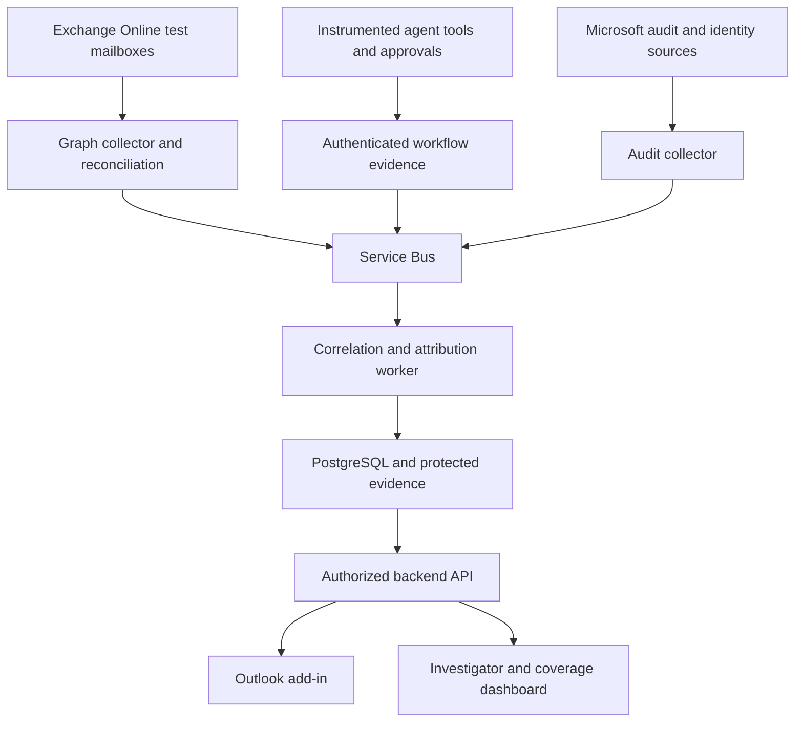

# AgentTrace implementation plan

- **Project:** AgentTrace
- **Primary workspace:** `C:\AgentDetection`
- **Repository:** [Kkb113/AgentTrace](https://github.com/Kkb113/AgentTrace)
- **Plan date:** 28 October 2026
- **Status:** Proposed delivery baseline; implementation and validation have not started.
- **Delivery scope:** 14 phases, numbered Phase 0 through Phase 13.

AgentTrace will attribute AI-agent actions associated with Outlook and Exchange Online email. It will identify the actions performed, the responsible application or agent, any human approval, and the evidence supporting the result. The MVP/POC will prioritize low false positives, explicit coverage limits, reproducible decisions, and protection of sensitive email data.

The strongest attribution will be available for instrumented internal workflows and cooperating senders. Arbitrary external messages and agents operating through unobserved human sessions can be indistinguishable from ordinary email. AgentTrace must preserve an unknown result in those cases. No phase authorizes a claim of universal agent detection or production regulatory compliance.

## 1. Product definition and scope

### What counts as agent involvement

An AI system participates when it executes an email-workflow action on behalf of a user or organization: reading relevant mailbox content, creating or modifying a draft, selecting recipients, scheduling, forwarding, replying, or sending. Human approval does not remove agent involvement.

A person asking ChatGPT to write text, manually copying it into Outlook, and manually sending it is outside the target definition. Generated wording alone is not evidence that an agent operated the mailbox. Conventional rules, scheduled scripts, and business applications without an AI workflow are separate automation categories.

Agent participation and send execution are distinct. The primary product question is whether an agent executed the sending action; broader workflow participation is a separate result. An agent-created draft sent by a person is an agent-involved workflow, but it must not be presented as an agent-executed send. A read of a conversation must not automatically attribute every past or future message in that conversation to the agent. An agent reading an incoming message on the recipient side provides no evidence that its external sender used an agent.

| Scenario | Required treatment |
| --- | --- |
| Human composes and sends manually | Record available human-interaction evidence; do not invent proof that no agent participated |
| Human copies AI-written text into Outlook and sends | No agent verdict based on text; excluded from positive ground truth |
| Non-AI script sends email | Conventional automation when its execution is verified |
| Agent creates a draft, then a person sends | Agent involvement verified if linked; send execution recorded separately |
| Agent sends after per-message human approval | Agent send verified if linked; approval recorded separately |
| Agent sends autonomously under standing authorization | Agent send verified if linked; standing authorization is distinct from per-message approval |
| Unknown application calls an email API | Application operation observed; AI involvement unknown without stronger evidence |
| External message declares an agent in an unsigned header | Unverified declaration; no verified attribution |
| Agent uses an uninstrumented browser or shared credentials | Assess available evidence; preserve unknown where attribution is unsupported |

### Initial deployment boundary

- One customer-controlled Microsoft 365 tenant and Azure subscription, both already available.
- Exchange Online, Outlook on the web, and new Outlook for Windows as the initial supported clients.
- A small, explicitly allowlisted set of test mailboxes, including a shared mailbox if supported by the validated permission design.
- Internal inbound and outbound messages, plus external inbound messages to those mailboxes.
- One instrumented test agent with human-approved and autonomous modes, one non-AI sender, and an independent external test sender where available.
- Synthetic business data during development; any pilot use of real email requires the customer-approved access and retention configuration established in Phase 0.
- Customer-hosted Azure deployment. Detection is observation-only by default. Optional prevention is limited to actions passing through the controlled agent tool boundary.

### Explicitly deferred scope

- Phone calls, voice analysis, consumer Outlook.com, Exchange on-premises, and comprehensive mobile or classic Outlook support.
- Universal detection of undisclosed external agents or browser-controlled agents.
- AI-written-text classification as an input to an agent verdict.
- Enterprise-wide mail routing changes, automatic quarantine, and production blocking based on statistical suspicion.
- Full DLP, malware filtering, or replacement of Microsoft identity and information-protection controls.
- Broad multi-tenant SaaS operation, high-availability certification, and jurisdiction-specific compliance certification.

## 2. Architecture and technology decisions

| Component | Baseline choice | Responsibility |
| --- | --- | --- |
| Outlook add-in | Office.js, React, TypeScript, Fluent UI | Display evidence for the selected message and supported approval interactions |
| Investigator dashboard | React, TypeScript, Fluent UI | Search, timelines, review, coverage, and authorized evidence exports |
| API and contracts | Python, FastAPI, Pydantic | Authenticated ingestion, queries, schema validation, and decision APIs |
| Attribution workers | Python; versioned deterministic rules initially | Correlate evidence and produce auditable results |
| Mail integration | Microsoft Graph v1.0 | Scoped message reads, subscriptions, delta reconciliation, and test-agent draft/send operations |
| Audit integration | Office 365 Management Activity API; Graph activity logs where licensed | Independent Microsoft evidence and application activity |
| Identity | Entra ID, MSAL, managed identities | User sign-in, workload authentication, and least-privilege access |
| Agent inventory | Entra Agent ID where available, plus a controlled local registry | Resolve agents, owners, applications, and trusted workflow integrations |
| Queue | Azure Service Bus | Durable asynchronous work, retries, and dead-letter handling |
| Operational database | Azure Database for PostgreSQL | Message references, actors, actions, approvals, correlations, and decision versions |
| Evidence objects | Azure Blob Storage | Encrypted, access-controlled evidence; retention and optional immutability policies |
| Keys and secrets | Azure Key Vault | Signing keys and required credentials; rotation and access auditing |
| Hosting | Azure Container Apps and Azure Container Registry | API, workers, and scheduled jobs |
| Observability | OpenTelemetry, Azure Monitor, Log Analytics | Sanitized traces, connector health, latency, and operational alerts |
| Infrastructure and CI | Bicep and Azure DevOps pipelines, connected to GitHub | Repeatable deployment, secret-free CI, rollback, and artifact versioning |
| Test tooling | pytest, Playwright, integration and scenario harnesses | Unit, contract, UI, adversarial, and end-to-end validation |

Pin supported dependency versions during Phase 1. Use one backend codebase with separate API and worker processes before considering additional services. The attribution service does not need a GPU, vector database, generative classifier, or model training. An approved model endpoint is needed only for the test agent when exercising genuine AI workflows.



### Microsoft constraints that affect the design

- Outlook notifications support mailbox change monitoring, but ingestion must manage subscription renewal, duplicates, outages, and reconciliation. Message delta synchronization is per folder. [Microsoft change notifications](https://learn.microsoft.com/en-us/graph/outlook-change-notifications-overview) and [message delta queries](https://learn.microsoft.com/en-us/graph/delta-query-messages).
- Graph webhooks require a reachable HTTPS endpoint. Validate notifications and durably queue work before acknowledging successful receipt; keep private data stores behind their access boundaries. [Webhook delivery guidance](https://learn.microsoft.com/en-us/graph/change-notifications-delivery-webhooks).
- Request immutable message IDs consistently. They are stable within a mailbox, not global identifiers shared between sender and recipient copies. Archive moves and export/re-import can change them. [Immutable identifiers](https://learn.microsoft.com/en-us/graph/outlook-immutable-id).
- A send API response of `202 Accepted` confirms request acceptance, not completed sending or delivery. [Graph sendMail](https://learn.microsoft.com/en-us/graph/api/user-sendmail?view=graph-rest-1.0).
- Microsoft audit evidence is asynchronous. Core-service records are typically available after 60–90 minutes, with no guaranteed availability time. This evidence supports later corroboration; it is not the synchronous authorization path. [Audit availability](https://learn.microsoft.com/en-us/purview/audit-search).
- Graph activity logs require Entra ID P1 or P2 and expose request metadata. A request URI such as `/sendMail` may not identify a particular message, so it must not be joined to a message using only subject and approximate time. [Graph activity logs](https://learn.microsoft.com/en-us/graph/microsoft-graph-activity-logs-overview).
- Exchange Application RBAC grants and Entra application permissions are additive. An unscoped Entra grant can defeat an intended mailbox restriction. Test effective access, including negative cases. [Application RBAC](https://learn.microsoft.com/en-us/exchange/permissions-exo/application-rbac).
- The add-in is not a universal interception layer. Supported client events do not cover arbitrary server-side sends, and a send-button interaction does not prove human operation. [Smart Alerts](https://learn.microsoft.com/en-us/office/dev/add-ins/outlook/onmessagesend-onappointmentsend-events).
- Use current MSAL/nested app authentication on supported clients. Legacy Exchange Online identity and callback tokens are unsupported. The backend must validate access tokens for its own audience and enforce mailbox-level authorization. [Outlook authentication](https://learn.microsoft.com/en-us/office/dev/add-ins/outlook/faq-nested-app-auth-outlook-legacy-tokens).
- Entra Agent ID can supply useful registered identity metadata. Availability, licensing, and integration behavior must be checked in the actual tenant; absence of that identity type is not evidence of human origin. [Agent identities](https://learn.microsoft.com/en-us/entra/agent-id/agent-identities).

## 3. Evidence, decisions, and acceptance rules

### Required record structure

Each message assessment should include:

- Tenant and mailbox scope, mailbox-local immutable ID, `internetMessageId` where present, and explicit links between different copies. Email-provided identifiers are untrusted inputs and are not unique proof by themselves.
- Direction, observed message state, event time, ingestion time, and observation coverage.
- Actor identity, application/service-principal identity, agent/workflow identity where established, workflow version, and delegated user or owner where available.
- Exact action, affected object, execution ID, validated correlation links, and source request/response references. Record the actor side as sender, recipient, intermediary, or unknown.
- Approval status, approver identity, authority, expiry, and the exact content/recipient version approved.
- Evidence source, issuer, trust status, signature/key reference if applicable, schema version, canonicalization version, and evidence digest.
- Attribution result, send-executor result, evidence completeness, applicable policy, reason codes, decision version, and superseded decision references.

Store two attribution results: `agent_send_attribution` for the primary sender-side question and `agent_participation` for the broader observed workflow. Each uses `verified_agent`, `suspected_agent`, `unknown`, or `no_agent_observed_in_monitored_path`. The last value is a bounded observation, not proof of a human-only origin. A recipient-side agent read cannot promote `agent_send_attribution`. Keep observed human interaction and verified conventional automation as separate evidence/mechanism fields.

Send executor is separately recorded as `agent`, `human_interaction_observed`, `conventional_automation`, or `unknown`. Human approval is separately recorded as `per_message_verified`, `standing_authorization_verified`, `no_per_message_approval_in_complete_workflow`, or `unknown`. Missing approval telemetry never means that approval did not occur.

Evidence completeness is `pending`, `sufficient_for_stated_claim`, `incomplete`, or `conflicting`. A verified workflow event may support attribution before Microsoft corroboration arrives; the interface must identify that basis and the pending source. Contradictions trigger a new assessment instead of silently preserving certainty.

### Trust rules

1. Verified attribution requires a trusted agent/workflow identity and a reliable link to the specific action and message. An application name, registration entry, or header alone is insufficient.
2. The controlled execution service, not the model output, creates action evidence. Authentication, runtime access controls, signed records, and independent send observations establish the trust boundary.
3. A signature proves that an issuer signed a claim. It does not prove the claim's truth, that a model was invoked on every execution, or that the issuer is uncompromised.
4. Body style, copied AI text, generic API usage, SPF/DKIM/DMARC success, a fast reply, or an `Auto-Submitted` header must never individually establish agent involvement.
5. Treat untrusted email content and declarations as data. They cannot change policy, invoke tools, update trust, or instruct the detector.
6. Do not convert absent evidence into a human verdict. Do not propagate agent involvement across an entire conversation without action-specific links.
7. Record conflicts and late evidence. Reassessment is append-only and reproducible against a pinned rule version.
8. Scope all claims to the observed path. Compromised trusted signing services or agents using unobserved human sessions remain explicit threat-model limits.

### Quantitative quality gates

These are proposed acceptance targets, not achieved performance or contractual service levels. Phase 0 may tighten them. Any relaxation requires a documented rationale and project-owner decision before the locked evaluation begins.

| Gate | Required target |
| --- | --- |
| G1 Verified-verdict false positives | One-sided 95% upper confidence bound on the false-positive rate no greater than 0.1%, evaluated separately for verified agent sending and verified workflow participation against their respective negative populations; zero errors in at least 3,000 independent negatives is one sufficient binomial case |
| G2 Supported-path agent-send recall | At least 99% observed recall on at least 1,000 independently labeled agent-executed sends spanning approved and autonomous modes, multiple workflows, and varied content; publish the confidence interval and scenario counts; report broader participation recall separately |
| G3 Send-executor correctness | No agent-send verdict for the mandatory agent-draft/human-send, copy-and-paste, or non-AI-automation counterexamples |
| G4 Evidence integrity | No verified verdict from forged, replayed, expired-for-use, wrong-tenant, wrong-message, or mismatched-approval evidence in the mandatory attack suite |
| G5 Application processing latency | P95 under five seconds from arrival of the last required evidence for the stated decision to persisted result, at the agreed pilot workload |
| G6 End-to-end visibility | Report action-to-observation, source lag, observation-to-decision, and decision-to-UI latency independently; no real-time claim for delayed Microsoft audit feeds |
| G7 Reconciliation | All observable events/messages in controlled outage and replay fixtures recovered or explicitly accounted for as unrecoverable coverage gaps; no silent loss or duplicate logical decisions |
| G8 Access isolation | Zero successful cross-mailbox or cross-tenant unauthorized reads, decisions, exports, or approval actions in the authorization suite |
| G9 Pilot operation | At least ten consecutive business days after the last material fix, with no unresolved critical/high release-blocking issue or unexplained data loss |

For the primary agent-send result, a false positive is a message not sent by an agent receiving a verified agent-send verdict. An agent-created draft manually sent by a person is negative for agent sending and positive for workflow participation. For participation, a false positive is a workflow without agent actions receiving a verified participation verdict. Use separate confusion matrices and negative denominators; examples may contribute to both when their labels justify it. Include recipient-side agent reads among the counterexamples for sender attribution. Report `suspected_agent` false alerts and reviewer burden separately; do not hide a noisy suspicion channel behind a low verified-verdict error rate. Overall precision must be reported at observed deployment prevalence and, where useful, at explicitly labeled prevalence scenarios.

For supported-path recall, unknown and pending results after the declared observation window count as misses. Also report recall across all labeled agent scenarios, including uninstrumented paths, so high registered-path recall cannot be marketed as universal recall. Report attribution coverage, unknown rate, and source availability with all headline metrics.

Repeated templates, multiple copies of one email, and correlated executions are not automatically independent observations. Split evaluation by sender, workflow, thread, and time; use grouped or cluster-aware uncertainty estimates when necessary. Do not claim the same bound for a subgroup that lacks adequate evidence. Review samples of unflagged messages as well as alerts.

## 4. Phase overview

All phases start as **Not started**. A phase is complete only when its exit criteria have recorded evidence. A plan, implementation, and test result are distinct artifacts.

| Phase | Focus | Primary dependency | Principal exit artifact |
| --- | --- | --- | --- |
| 0 | Scope, threat model, tenant feasibility, acceptance contract | None | Approved baseline and capability matrix |
| 1 | Repository, architecture, contracts, local environment, CI | 0 | Reproducible project foundation |
| 2 | Tenant identity, permissions, secure connectivity | 0–1 | Tested access and telemetry configuration |
| 3 | Graph and audit ingestion with recovery | 2 | Reliable scoped event collection |
| 4 | Evidence ledger and exact message/action correlation | 1–3 | Reproducible evidence chain |
| 5 | Independent ground truth and scenario harness | 0–4 | Versioned labeled scenario corpus |
| 6 | Agent tools, approval binding, send verification | 2–5 | Instrumented approved and autonomous workflows |
| 7 | Passive and external evidence adapters | 3–6 | Measured coverage beyond instrumented sends |
| 8 | Attribution rules, abstention, and policy separation | 4–7 | Versioned decision engine |
| 9 | Outlook and investigator experiences | 8 | Authorized, evidence-backed product UI |
| 10 | Adversarial, security, and reliability hardening | 2–9 | Closed release-blocking findings |
| 11 | Locked evaluation and false-positive qualification | 5, 8–10 | Reproducible evaluation report |
| 12 | Azure shadow pilot and operational readiness | 11 | Completed pilot and operational evidence |
| 13 | Stakeholder demonstration and release handover | 12 | Tagged POC release and acceptance pack |

## Phase 0 — Establish scope, risk boundaries, and feasibility

**Objective:** Agree on exactly what AgentTrace will identify and prove that the available Microsoft environment can supply the necessary evidence.

**Implementation work**

- Confirm industry, jurisdiction, data classifications, permitted Azure region, retention requirements, and approval owners. Treat these as requirements to resolve, not assumed compliance claims.
- Record target clients, test mailboxes, external test paths, pilot volume, and intended use of results. Define which actions are in scope and how draft participation differs from send execution.
- Inventory Microsoft 365, Entra, Purview, and Azure capabilities and licenses. Verify audit enablement, Graph activity-log eligibility, Entra Agent ID availability, and supported add-in authentication.
- Run a minimal synthetic feasibility spike: manual send, non-AI application send, and agent-tool send. Inspect actual event schemas, identifiers, field availability, and observed lag. Test whether a message/action correlation can be demonstrated without subject/time guessing.
- Define the threat model: forged headers, shared applications, stolen credentials, compromised issuers, browser automation, delayed logs, copied text, and misleading self-declarations.
- Freeze the metric definitions, acceptance gates G1–G9, supported-path boundary, and response to unknown evidence. Define a separate approval route for any future production enforcement.

**Expected outcomes**

- `docs/scope.md`, `docs/threat-model.md`, `docs/acceptance.md`, and a tenant capability matrix using sanitized identifiers.
- A concrete list of supported sources, known blind spots, and unavailable prerequisites.
- A small evidence sample showing a viable exact-message attribution path.

**Validation criteria**

- Reproduce at least one send and its associated mailbox evidence in the test tenant.
- Confirm that copied AI text and conventional automation are negative ground-truth cases.
- Measure available audit latency rather than assuming synchronous logs.
- Verify the proposed region, data handling, and access model with the customer technical owner.

**Exit criteria**

- [ ] Project owner accepts the scope, terminology, threat model, and quantitative gates.
- [ ] Microsoft administrator confirms required access and available licenses.
- [ ] An exact-message evidence path is demonstrated, with unresolved gaps documented.
- [ ] Synthetic-data policy and test recipients are approved for the pilot environment.
- [ ] No unresolved dependency prevents the minimum end-to-end path; unavailable optional feeds have explicit fallback/coverage behavior.

## Phase 1 — Create the repository and reproducible foundation

**Objective:** Establish a maintainable codebase in `C:\AgentDetection` that can be built, tested, and deployed from a clean checkout.

**Implementation work**

- Initialize the working checkout against the supplied GitHub repository without overwriting unrelated work. Keep this plan at the repository root.
- Establish the directory structure below, dependency lockfiles, formatting, type checks, unit-test runners, and documented developer commands.
- Define API/event contracts and initial architecture decision records, including deterministic attribution, separate sender and collector identities, and metadata-first storage.
- Configure local PostgreSQL and a documented development queue adapter. Integration CI must also exercise actual Azure Service Bus semantics before release.
- Add Bicep modules and Azure DevOps CI with workload identity federation where supported. Never commit cloud credentials or real message fixtures.
- Configure secret scanning, dependency and license checks, protected main-branch workflow where available, and pull-request validation. Add a documented alternative if repository-plan features are unavailable.

**Expected outcomes**

```text
C:\AgentDetection\
  implementation.md
  apps\api\
  apps\worker\
  apps\dashboard\
  apps\outlook-addin\
  packages\contracts\
  packages\attribution\
  packages\agent-tools\
  tests\unit\
  tests\integration\
  tests\scenarios\
  tests\security\
  tests\e2e\
  infra\bicep\
  scripts\
  docs\adr\
  docs\runbooks\
```

Large datasets, raw evidence, production logs, and test artifacts containing sensitive data belong in approved artifact storage, not Git. Commit only safe manifests, synthetic fixtures, and sanitized reports.

**Validation criteria**

- A second clean checkout can install pinned dependencies, start local services, run health checks, and execute the baseline test commands.
- CI fails for a deliberately invalid contract, a failing test, and a synthetic secret-scanning fixture.
- Infrastructure validation runs without provisioning unapproved production resources.

**Exit criteria**

- [ ] Repository foundation and architecture decisions are reviewed and committed.
- [ ] Clean-checkout setup and CI are reproducible.
- [ ] Required checks run on a pull request.
- [ ] No credentials, real email, or tenant-specific sensitive values are present in tracked files.

## Phase 2 — Configure tenant access and secure identities

**Objective:** Connect to Microsoft 365 and Azure with explicitly scoped, testable permissions.

**Implementation work**

- Create separate identities for mailbox collection, audit collection, the demo sender, backend workloads, and interactive users as appropriate to the tenant design.
- Scope collector access to approved mailboxes. Grant sender write/send capabilities only to the test-agent identity and mailboxes that require them.
- Validate effective Exchange Application RBAC and Entra permissions together. Remove redundant unscoped grants that defeat the intended restriction.
- Configure Graph notification ingress, Service Bus, PostgreSQL, Blob Storage, Key Vault, managed identities, and controlled network access.
- Enable required audit feeds through approved administrator configuration. Document that audit feeds can expose broader tenant information and restrict collection, processing, and investigator access accordingly.
- Configure Entra application roles for viewer, investigator, and administrator. Plan selected-message authorization for the add-in independently of the collector's broader service permissions.

**Expected outcomes**

- `docs/permissions-matrix.md` mapping every identity to operations, resources, scopes, consent, and owner.
- Deployable sandbox configuration with access logs and credential rotation procedures.
- Verified connectivity to the selected evidence sources.

**Validation criteria**

- Collector can read an allowed mailbox and cannot read an out-of-scope mailbox.
- Collector cannot send, alter, or delete messages.
- Demo sender cannot operate on an unapproved mailbox.
- Backend rejects expired tokens, wrong audiences, wrong tenants, and unauthorized roles.
- Database, queue, object storage, and signing operations reject unauthorized identities.

**Exit criteria**

- [ ] Positive and negative permission tests pass using effective API calls, not configuration screenshots alone.
- [ ] No tenant-wide mail grant unintentionally bypasses the pilot scope.
- [ ] Signing keys and credentials are absent from application code and routine logs.
- [ ] Microsoft administrator and security owner accept the permission matrix and data flow.

## Phase 3 — Implement reliable mailbox and audit ingestion

**Objective:** Collect the observable email and Microsoft events with explicit freshness, completeness, and failure states.

**Implementation work**

- Implement mailbox subscriptions with immutable-ID preference, notification validation, lifecycle handling, renewal, and durable queue acknowledgment.
- Add incremental reconciliation for every supported folder. Track checkpoints, folder moves, deleted items, and invalid/expired delta state; document cases where a full scoped resynchronization is required.
- Fetch only required fields. Retrieve headers or MIME only when the evidence need justifies access and retention. Handle protected, encrypted, inaccessible, or deleted messages as explicit evidence gaps.
- Add Office 365 audit collection and eligible Graph activity-log collection with source-specific checkpoints, rate limits, and lookback overlap.
- Implement idempotency, retries with backoff, `Retry-After` handling, dead-letter queues, queue-age monitoring, and replay tools.
- Store source-event time and ingestion time separately. Identify and exclude the collector's own actions from agent-attribution signals while preserving them for access auditing.
- Do not equate a Sent Items creation notification with proof of the initiating actor. Preserve the observation for later correlation.

**Expected outcomes**

- Working collectors, sanitized normalized events, source health endpoints, and reconciliation runbooks.
- An ingestion inventory showing which messages/events were observed, retried, or unavailable.

**Validation criteria**

- Exercise normal sends, replies, forwards, mailbox moves, shared-mailbox behavior, duplicate notifications, and out-of-order updates.
- Simulate subscription expiry, service restart, webhook outage, token expiry, throttling, and malformed notifications.
- Reconcile deliberately missed observable messages without duplicating logical records.
- Verify that a source gap changes coverage state instead of implying no agent activity.

**Exit criteria**

- [ ] Controlled outage/replay fixtures pass G7 with explicit accounting for unrecoverable gaps.
- [ ] Subscription, checkpoint, and dead-letter health are visible.
- [ ] Notification handlers persist accepted work before acknowledgment.
- [ ] Content access and retention follow the approved minimum-data policy.

## Phase 4 — Build the evidence ledger and correlation model

**Objective:** Link actors and actions to the correct message using evidence that can be inspected and reproduced.

**Implementation work**

- Implement the record structure in Section 3, schema migrations, tenant/mailbox boundaries, and append-only decision history.
- Separate sender/recipient mailbox copies and maintain explicit mappings. Do not treat immutable IDs or `internetMessageId` as universally unique across all sources.
- Implement exact identifier joins where supported. Mark time/subject/recipient similarity as candidate correlation only, never sufficient for a verified attribution.
- Define a versioned canonical representation of approved content, recipients, and attachment digests. Hash that representation; preserve transport observations separately because Exchange can transform MIME.
- Implement trusted issuer enrollment, authenticated evidence submission, signature verification, key rotation, revocation handling, event uniqueness, and replay detection.
- Protect persisted evidence against application-level modification using least privilege, append-only writes, audit trails, and tested storage policies. A database hash by itself is not an immutable ledger.
- Define conflict handling, evidence invalidation, and historical reassessment when an issuer or key becomes untrusted.

**Expected outcomes**

- `docs/evidence-schema.md`, `docs/correlation-rules.md`, and a versioned evidence API.
- A retrievable chain from a synthetic workflow event to a specific message and decision input.

**Validation criteria**

- Test identical subjects, identical bodies, concurrent sends, copied messages, forward chains, duplicate message IDs, mailbox moves, and archive boundaries.
- Verify that wrong-message, wrong-tenant, altered, stale-for-use, and replayed evidence is rejected or downgraded.
- Reconstruct the same evidence view from stored events after a service restart.

**Exit criteria**

- [ ] Exact joins and uncertain candidate joins are distinguishable in storage and APIs.
- [ ] Signature and replay tests pass without promoting untrusted declarations.
- [ ] Canonicalization and transport-mapping limitations are documented and tested.
- [ ] Every persisted decision input has a traceable source and schema version.

## Phase 5 — Establish independent ground truth and scenario generation

**Objective:** Create a trustworthy evaluation harness before optimizing the detector.

**Implementation work**

- Build a controlled harness that runs human-operated, copied-text, conventional-automation, human-approved-agent, and autonomous-agent scenarios against test mailboxes.
- Record ground truth through a separate test controller and scenario manifest. Test labels must not be supplied to the detector or inferred from its output.
- Use matching email text and overlapping infrastructure across different actor classes. Include both AI and non-AI executions through the same application identity where practical.
- Add agent-draft/human-send, sender-side and recipient-side agent-read-only actions, human-edited agent drafts, failed sends, canceled approvals, shared mailboxes, and external unknown cases. Label send execution and participation independently.
- Plan a browser-operated uninstrumented-agent case to demonstrate the visibility boundary; do not omit difficult positives from overall recall reporting.
- Create development, calibration, and locked evaluation splits separated by workflow, sender, thread, template family, and time. Register dataset versions and permitted uses.
- Include realistic short, formal, multilingual, translated, quoted, and attachment-bearing emails without treating their wording as agent ground truth.

**Expected outcomes**

- Versioned scenario matrix, safe fixture manifests, label definitions, and a reproducible execution harness.
- A dataset expansion plan sufficient for G1 and G2, with independence and subgroup limitations recorded.

**Validation criteria**

- A reviewer can verify the action provenance of sampled labels without consulting AgentTrace decisions.
- Identical text sent through different workflows receives different ground truth where appropriate.
- No filenames, hidden headers, synthetic domains, scenario names, or evaluation labels leak the target class into the detector.
- Ambiguous labels are quarantined for adjudication instead of forced into the test set.

**Exit criteria**

- [ ] All mandatory scenario families have executable cases and reviewed expected outcomes.
- [ ] Ground truth is independent of detector rules and self-reported email headers.
- [ ] Split and leakage checks pass.
- [ ] Locked evaluation data is access-controlled and not used for rule tuning.

## Phase 6 — Instrument agent actions and bind human approval

**Objective:** Produce trustworthy, action-level evidence for both approved and autonomous AI workflows.

**Implementation work**

- Implement an authenticated tool boundary for mailbox reads, draft creation, recipient changes, approval requests, and sends.
- Associate each execution with a registered workflow, actor identity, owner, workflow version, and permitted mailbox scope. Shared applications require per-execution context; an app ID alone cannot select the agent verdict.
- Record events in the execution service after validating the caller and observed operation. Do not accept a model-generated `is_agent` flag as proof.
- Bind per-message approval to the exact payload version, recipient set, mailbox, operation, approver authority, and validity period. Any relevant mutation invalidates approval.
- Distinguish standing authorization from per-message approval. Autonomous test sends must still operate within their approved scope and test recipient allowlist.
- Prefer create-draft-then-send with retained immutable identifiers for the instrumented path. Correlate the later Sent Items observation and Microsoft request identifiers.
- Handle ambiguous send outcomes safely. Do not blindly retry a timed-out send and produce duplicate real email; reconcile or require explicit recovery. Do not promise exactly-once delivery from an API that does not provide it.
- Authenticate the approval action, protect against CSRF/replay, and separate the agent identity from the human approver. Approval records attest an authorized interaction, not absolute biological-human proof.

**Expected outcomes**

- A reusable agent-tool package, protected approval service, and two working demo workflows.
- Complete execution records for approved and autonomous sends, plus rejected or canceled operations.

**Validation criteria**

- Run genuine AI workflows using synthetic data and an approved model endpoint.
- Change recipients, attachments, and body after approval and verify that prior approval cannot authorize the changed send.
- Test repeated approval, expired approval, wrong approver, failed send, timeout, and replay.
- Verify that agent-created drafts sent manually remain distinct from agent-executed sends.

**Exit criteria**

- [ ] Both approved and autonomous workflows produce an exact-message evidence chain.
- [ ] Mandatory approval attacks and duplicate-send recovery cases pass.
- [ ] API acceptance, observed sent state, and delivery confirmation are separate states.
- [ ] Collected evidence supports only the actions actually observed.

## Phase 7 — Add passive attribution and external evidence handling

**Objective:** Expand visibility beyond the controlled tool path without overstating what recipient-side evidence can establish.

**Implementation work**

- Import registered agent/application metadata from approved tenant sources, including Entra Agent ID when available, and maintain owner-reviewed mappings.
- Correlate application and mailbox audit activity only where a reliable object/action link exists. Keep unmatched or ambiguous API activity available for investigation without assigning it to a guessed email.
- Support a cooperating external sender through a documented trust profile: issuer enrollment, keys, signed statement format, message binding, replay handling, and revocation.
- Parse automation and attribution headers as declarations with provenance. Verify any relevant signature coverage and trusted issuer before elevating a claim.
- Treat SPF, DKIM, and DMARC as authentication context, not AI-agent proof. Inspect only authentication results from established trusted sources.
- Record browser/session automation, SMTP paths, shared connectors, unsupported integrations, and protected messages as measured coverage limits.
- Keep any experimental anomaly features behind flags; they may support a suspicion workflow only after separate validation and cannot create verified status.

**Expected outcomes**

- Passive telemetry adapters, external declaration parser, trusted-partner test integration, and source-specific coverage matrix.
- Visible distinctions between verified workflow evidence, declared evidence, candidate correlations, and unknowns.

**Validation criteria**

- Send forged, stripped, duplicated, forwarded, and modified declarations through the external test path.
- Confirm that a known application identity used by non-AI automation does not become an automatic agent verdict.
- Demonstrate an undisclosed external or browser-operated agent case and report its actual detection limit.
- Confirm that third-party declarations cannot enroll their own issuer or change trust policy.

**Exit criteria**

- [ ] Untrusted declarations cannot produce verified attribution.
- [ ] Passive correlations expose their exact scope and ambiguity.
- [ ] At least one cooperating external case works, or its unavailable prerequisite is explicitly excluded from release claims.
- [ ] Coverage documentation includes unsupported and evasive paths, not only successful examples.

## Phase 8 — Implement conservative attribution and policy decisions

**Objective:** Convert evidence into stable, explainable outcomes while preserving uncertainty and minimizing false accusations.

**Implementation work**

- Implement the status model, trust rules, and versioned reason codes defined in Section 3.
- Use deterministic rules for verified provenance. Introduce statistical scoring only if an independently evaluated need exists; it is not required for MVP completion.
- Separate agent participation, send executor, human approval, evidence completeness, and business-policy disposition.
- Define pending-evidence windows using measured source behavior. Missing evidence after a window becomes incomplete/unknown, not a human verdict.
- Add conflict resolution and append-only reassessment. Preserve the original decision, evidence set, and rule version.
- Keep observation and enforcement separate. Optional tool-boundary prevention uses explicit authorization rules; suspicion alone does not block ordinary Outlook delivery.
- Return evidence references and bounded explanations through the API. Avoid unsupported numerical confidence and any biological-human certification.

**Expected outcomes**

- A reproducible decision engine, policy configuration, and machine-readable decision API.
- An explanation for each result that states what is established and what remains unresolved.

**Validation criteria**

- Replay the development scenario suite, including conflicting sources and late corroboration.
- Verify that text changes alone cannot change actor attribution when workflow evidence is unchanged.
- Verify that non-AI app sends, forged headers, and human-sent AI text cannot independently produce verified-agent results.
- Verify that the same versioned evidence and rules reproduce the same result.

**Exit criteria**

- [ ] Mandatory semantic and trust-rule tests pass.
- [ ] Every verdict includes reason codes, source references, and decision version.
- [ ] Unknown, pending, conventional automation, and approval distinctions survive API round trips.
- [ ] Enforcement is disabled by default outside the explicitly controlled test-agent boundary.

## Phase 9 — Build Outlook, investigator, and coverage experiences

**Objective:** Present attribution clearly to email users and investigators without exposing evidence beyond their authorization.

**Implementation work**

- Build an Outlook read-pane add-in showing the selected message's result, observed actions, approval state, evidence freshness, and source limitations.
- Use MSAL with supported nested app authentication and a tested fallback where required by the selected client. Authorize backend access with an access token for the backend audience.
- Map the selected item to the correct mailbox/message context. Validate access server-side; never trust a mailbox or message ID supplied by the browser as authorization.
- Build dashboard views for message search, action timeline, source evidence, review/correction, registered integrations, and operational coverage.
- Add role-controlled evidence exports with data minimization and export auditing. Avoid arbitrary recipient access to internal approver names or sensitive workflow details.
- Show pending Microsoft corroboration, unavailable sources, and unknown outcomes without labeling the message as safe, human, or malicious.
- Design accessible keyboard navigation, readable status text, and non-color-only indicators. Sanitize message-derived HTML and links.

**Expected outcomes**

- An admin-deployable add-in manifest, working Outlook panel, and investigator/coverage dashboard.
- A coherent product demonstration based on actual backend evidence.

**Validation criteria**

- Test Outlook on the web and new Outlook for Windows against the declared supported versions.
- Exercise cross-mailbox guessing, wrong-tenant tokens, revoked access, stale decisions, empty results, and evidence delays.
- Confirm UI results match backend decision records and distinguish agent drafting from agent sending.
- Run accessibility and end-to-end tests for all principal user journeys.

**Exit criteria**

- [ ] Authorized users can inspect a real test message end to end in both supported clients.
- [ ] Unauthorized users cannot retrieve its assessment or evidence.
- [ ] No UI wording converts unknown into human or approval into absence of agent activity.
- [ ] Every displayed demo status is backed by a retrievable decision record.

## Phase 10 — Harden security, evidence integrity, and reliability

**Objective:** Test the system against mistakes and adversaries before measuring release performance.

**Implementation work**

- Exercise the threat model with forged headers, injected instructions, altered receipts, signer substitution, replay, cross-tenant IDs, approval mutation, malicious HTML, and ambiguous message correlation.
- Test key rotation, key compromise/revocation procedures, issuer removal, and historical decision reassessment.
- Test database migration, backup restoration, queue replay, poison messages, expired subscriptions, prolonged source lag, and interrupted deployments.
- Validate egress controls and ensure email content cannot trigger model calls, tool execution, trust changes, or arbitrary URL fetching.
- Scan dependencies, container images, infrastructure configuration, secrets, and permissions. Record findings and remediation evidence.
- Perform sustained load testing at the Phase 0 pilot workload and a documented burst level; measure source lag separately from application processing.
- Run data-retention deletion tests and verify that backup/evidence retention behavior matches the agreed policy.

**Expected outcomes**

- Security test report, reliability report, incident procedures, and a closed release-blocking issue list.
- Tested backup, restore, replay, revocation, and rollback procedures.

**Validation criteria**

- G3, G4, G7, and G8 pass across the mandatory suite.
- No content injection or malformed evidence can escalate trust or execute operations.
- Restore a representative environment and reproduce selected decisions from retained evidence.
- Meet G5 at the agreed workload and publish any performance bottlenecks.

**Exit criteria**

- [ ] All critical/high release-blocking security and reliability findings are resolved.
- [ ] Restore, replay, key rotation, and rollback have been executed successfully.
- [ ] Log and export review finds no prohibited secrets or message content.
- [ ] Residual limitations have an owner, mitigation, and explicit release-claim impact.

## Phase 11 — Qualify low false positives on locked evaluation data

**Objective:** Establish credible, reproducible performance evidence for the supported deployment scope.

**Implementation work**

- Freeze the rule version, correlation configuration, observation windows, dataset manifest, and any optional suspicion thresholds before evaluation.
- Evaluate at least 3,000 representative independently labeled negatives for each verified attribution target and 1,000 agent-executed sends, subject to the independence and scenario requirements in Section 3. Keep participation and send-execution labels and denominators separate.
- Include human text, copied AI text, non-AI automation, shared applications, approved agents, autonomous agents, draft-only participation, and uninstrumented positives.
- Measure verified-verdict false positives, suspicion false alerts, supported-path agent-send recall, broader participation recall, overall scenario recall, send-executor errors, precision, abstention, and source coverage. Recipient-side agent processing must not inflate sender-side recall.
- Publish one-sided confidence bounds for false positives and confidence intervals for recall/precision using justified binomial or cluster-aware methods.
- Evaluate key subgroups and out-of-scope paths separately. Do not average away a failure in a required counterexample class.
- Investigate all verified false positives and a representative sample of false negatives, unknowns, and unflagged messages. A fix after examining the holdout requires a new held-out evaluation or a clearly labeled exploratory result.

**Expected outcomes**

- `docs/evaluation-report.md`, a sanitized release scorecard, exact dataset/run manifests, and reproducible analysis commands.
- A precise statement of supported detection coverage and non-supported claims.

**Validation criteria**

- G1 and G2 pass with their required denominators and uncertainty reporting.
- G3 and G4 remain satisfied on the locked suite.
- Unknown/pending supported positives after the fixed window are counted as misses.
- Results can be recomputed from the stored predictions and independent labels.

**Exit criteria**

- [ ] G1–G8 are supported by recorded evidence for the declared scope.
- [ ] No holdout leakage, hidden exclusions, or unsupported independence assumptions remain.
- [ ] Required scenario failures are resolved and re-evaluated on uncontaminated data.
- [ ] If a numerical gate is unmet, qualification remains incomplete; results are not relabeled as a pass.
- [ ] Project owner accepts the measured scope and the exact wording of performance claims.

## Phase 12 — Run the Azure shadow pilot and establish operations

**Objective:** Demonstrate sustained behavior in the customer environment while keeping ordinary email delivery unaffected.

**Implementation work**

- Deploy the pinned release candidate through Bicep and CI to the agreed Azure region and pilot resource group.
- Enable only the approved mailbox and investigator groups. Keep general mail blocking and quarantine disabled.
- Run the shadow pilot for at least ten consecutive business days after the last material correction. Collect representative alerts, unflagged samples, unknowns, and source-health observations.
- Monitor source lag, queue depth, subscription renewal, retries, coverage, decision revisions, investigator workload, and cloud cost.
- Set Azure budget alerts, log retention, evidence retention, and capacity limits. Document the tested workload and compute/storage sizing.
- Exercise operational ownership: connector outage, dead-letter recovery, permission revocation, agent disablement in the controlled test environment, and customer support escalation.
- Validate whether delayed attribution remains useful to the target business workflow. Separately assess any demand for pre-action control at the agent boundary.

**Expected outcomes**

- Pilot report, operational dashboards, runbooks, cost baseline, and a customer-reviewed known-limitations register.
- An evidence-backed decision on whether the POC is ready for stakeholder acceptance or needs another iteration.

**Validation criteria**

- G9 passes, and observed pilot behavior does not invalidate G1–G8 or the stated scope.
- All pilot findings are reproducible or explicitly recorded as unresolved.
- Reviewer workload and unknown coverage are visible; unflagged sampling supports detection-quality assessment.
- Restore and rollback procedures remain valid in the deployed environment.

**Exit criteria**

- [ ] Ten-business-day observation period is complete after the last material fix.
- [ ] No unresolved critical/high issue, unexplained loss, or unauthorized access remains.
- [ ] Pilot data handling, retention, cost, and operational ownership are accepted.
- [ ] Any changes to supported scope or performance claims are reflected in the release documentation.

## Phase 13 — Deliver the demonstration and accepted POC release

**Objective:** Provide a convincing, honest demonstration and a reproducible handover package.

**Implementation work**

- Prepare a short presentation covering the target distinction, evidence architecture, live Outlook workflows, false-positive results, unknown coverage, and deployment permissions.
- Demonstrate matching message text across manual send, copied AI text, conventional automation, human-approved agent send, and autonomous agent send.
- Show agent-draft/human-send separation, forged external attribution, an uninstrumented path, and a telemetry outage. Explain the actual outcome rather than hiding unsupported cases.
- Use real test-mailbox operations for the live demonstration. Any replay used to illustrate delayed audit enrichment must be clearly labeled and linked to its original test evidence.
- Publish the source, infrastructure templates, add-in manifest, permission matrix, schema documentation, runbooks, evaluation report, and sanitized demo artifacts.
- Create a versioned release tag and document the exact commit, build, rules, schemas, infrastructure version, and evaluation manifest.
- Record customer acceptance and a separate production-readiness backlog for broader integrations, jurisdiction-specific controls, operational scale, and any enforcement capability.

**Expected outcomes**

- A deployable, demonstrable AgentTrace MVP/POC with a documented acceptance pack.
- A clear separation between achieved capabilities, measured limitations, and future work.

**Validation criteria**

- Rehearse the complete demonstration from a clean seeded environment.
- A reviewer can trace each displayed result to the actual message, evidence, and decision version.
- A second engineer can deploy the tagged release and reproduce the principal scenarios and evaluation analysis.
- Every numerical slide claim matches the final evaluation report and scope.

**Exit criteria**

- [ ] All earlier phase exits have linked evidence and recorded acceptance.
- [ ] Stakeholder demo succeeds, including uncertainty and attack cases.
- [ ] Source, deployment assets, documentation, and sanitized validation reports are committed and released.
- [ ] Customer technical owner accepts the POC against the agreed gates.
- [ ] Remaining production work is explicit; POC acceptance is not represented as regulatory certification or universal external-agent detection.

## 5. Delivery ownership and working practices

| Responsibility | Accountable role |
| --- | --- |
| Scope, priorities, acceptance, performance claims | Product/project owner |
| Graph integration, evidence, rules, backend | Backend/integration engineer |
| Outlook add-in, investigator UI, accessibility | Frontend/Outlook engineer |
| Tenant configuration, permissions, Microsoft licensing | Microsoft 365/Entra administrator |
| Threat model, access controls, privacy, release findings | Security/privacy reviewer |
| Independent labels, test design, uncertainty analysis | QA/evaluation owner |
| Azure deployment, monitoring, costs, recovery | Platform/operations owner |

One person may hold several roles, but the individual who changes attribution rules should not be the sole approver of evaluation labels and release claims. Required reviews are milestone gates, not repeated permission requests for routine implementation already within the agreed scope.

Maintain a phase checklist with status, evidence links, test/run identifiers, open defects, owner, and exit decision. Use feature branches and reviewed pull requests after repository bootstrap. Keep changes small enough to assess and deploy safely. When a later phase exposes an earlier assumption as false, reopen the affected gate and record the correction.

Use test accounts and explicit test-recipient allowlists. Never send test messages to real customers or unrelated addresses. Do not provision broad production permissions, change tenant-wide mail routing, or enable enforcement merely to make a demonstration easier.

## 6. Schedule, cost, and release boundaries

An initial engineering estimate is eight to twelve weeks with two engineers and part-time Microsoft administration, QA, security, and operations support. Refine this after Phase 0. The ten-business-day shadow period and statistically meaningful evaluation must not be compressed into a scripted demo. Some independent implementation tasks can overlap, but a dependent exit cannot pass before its prerequisite evidence exists.

Primary costs are Azure compute, PostgreSQL, Service Bus, storage, log ingestion/retention, and any missing Microsoft licensing. The test agent adds limited model usage. Record a cost estimate using the selected region, pilot throughput, retention, and license inventory in Phase 0; validate it with actual consumption in Phase 12. No fixed cloud-cost claim is made before those inputs are known.

The release must answer all of the following with evidence:

- Which supported email actions can be attributed to agents, and at what observed recall?
- How often are non-agent workflows incorrectly assigned a verified-agent result?
- What share of traffic is unknown, pending, or outside observed coverage?
- Which identities and evidence sources support each verdict?
- Can human-approved and autonomous actions be distinguished without conflating approval with agent absence?
- Can copied AI-written text and conventional automation pass without an agent accusation?
- Can forged or replayed evidence create a verified result?
- How long does attribution take, including Microsoft source delays?
- Can the customer deploy, inspect, recover, and operate the POC without exposing sensitive mail unnecessarily?

Completion means a measured, reproducible Outlook agent-attribution POC within its declared observation boundary. Expansion to additional channels or production enforcement begins from that evidence, not from a claim that all human and agent email is distinguishable.
