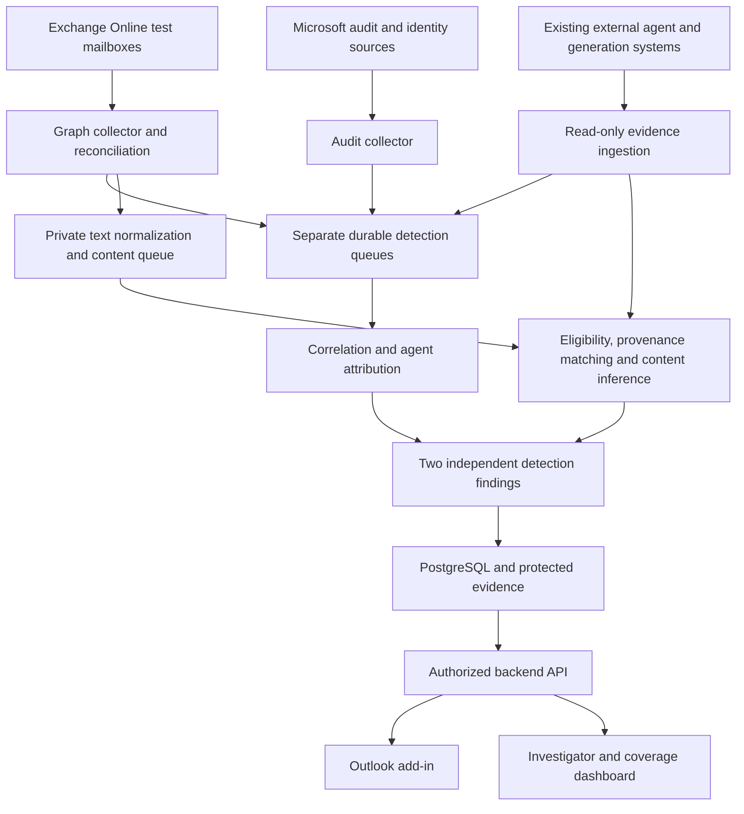

# AgentTrace implementation plan

- **Project:** AgentTrace
- **Primary workspace:** `C:\AgentDetection`
- **Repository:** [Kkb113/AgentTrace](https://github.com/Kkb113/AgentTrace)
- **Plan date:** 28 October 2026
- **Status:** Phases 0 through 3 are complete with recorded exit evidence. Reliable read-only mailbox/audit ingestion and offline extraction now complement the secured foundation. Statistical content scoring, later evidence/correlation engines, UI and release accuracy qualification remain later work. See [ingestion review](docs/mail-ingestion-report.md), [foundation review](docs/repository-foundation.md) and [feasibility report](docs/feasibility-report.md).
- **Delivery scope:** 15 phases, numbered Phase 0 through Phase 14.
- **Product boundary:** Detection only. Two independent findings: email sent by an AI agent; email contains AI-generated content. English first for content; distinguish basic spelling/grammar assistance from generated drafts and substantial rewrites/translations.
- **Priority:** Agent-sent detection is the primary release objective. Content detection is a required, measured best-effort capability; its accuracy does not determine whether the agent detector qualifies.
- **Azure constraint:** Use Azure CLI with an explicit subscription and the existing `kb-agentdemo` resource group. Start with local development and the smallest suitable consumption/basic/burstable resources; no standing GPU or premium infrastructure by default.
- **Research refresh:** Microsoft documentation, upstream repositories, model cards, and research papers reviewed on 28 October 2026. Recommendations below are implementation choices to validate, not achieved results.

AgentTrace is a **read-only email detection platform**. For an existing Outlook/Exchange Online email it produces exactly two independent detection results: **(1) email sent by an AI agent; (2) email contains AI-generated content.** Each result includes its flag, evidence basis, reasons, and uncertainty. A person manually pasting AI-written text into Outlook and sending it is a content-positive test case, not an agent-sent test case. Low false positives, explicit coverage limits, reproducible decisions, and protection of sensitive email data remain the priorities.

**Build and qualify agent-sent detection first.** Allocate the initial engineering effort to trustworthy send evidence, exact-message correlation, false-positive controls, and a working Outlook result. Run content experiments separately with bounded time and compute. A strong content score cannot create, strengthen, or resolve an agent-sent finding. An agent may send entirely human-written wording; a human may send entirely AI-written wording.

The POC must actually attempt statistical content detection on eligible English emails, including untracked copy/paste, and report scores, errors, and coverage. It need not achieve perfect authorship detection or a fixed content-recall figure to release the independently qualified agent detector. A failed content benchmark must remain visible as a measured limitation, with experimental scores restricted to the evaluation/investigator view and unsupported inputs marked unknown. Do not substitute an all-unknown stub or provenance-only demonstration for this required attempt.

AgentTrace does not create agents, generate or insert email drafts, send/reply/forward/schedule email, select recipients, request or manage approvals, orchestrate workflows, or block/quarantine mail. It reads authorized messages and available evidence, analyzes them, and stores/displays detection flags in its own API, dashboard, and read-only Outlook add-in. Background collection, scoring, and reassessment are internal detection operations. Records from existing third-party agents or generation tools are optional evidence inputs, not execution features of AgentTrace. Test emails are prepared outside the product with existing tools; the detection test harness only imports, reads, and replays them.

The strongest attribution will be available for instrumented internal workflows and cooperating senders. For untracked copy/paste, content detection is an inference, not proof of authorship. Short messages, substantial editing, unfamiliar generators, and ordinary human writing can make the distinction unreliable. The product must preserve unknown results and must not promise detection of every AI-written email. No phase authorizes a claim of universal detection or production regulatory compliance.

## 1. Product definition and scope

### What counts as an AI-agent-sent email

The first detection target is whether an AI agent executed the send action for the specific message. It remains an agent-sent email whether a person approved it first or it was sent autonomously. AgentTrace does not approve, authorize, or execute that action; it evaluates available evidence after the message/action is observable.

A person asking ChatGPT, Copilot, Claude, or another assistant to write text, manually copying it into Outlook, and manually sending it is outside the **agent-sent** definition but inside the **AI-content** scope. Generated wording alone is not evidence that an agent sent the email. Conventional rules, scheduled scripts, and business applications without AI are non-agent send mechanisms; their messages can still contain AI-generated text.

Draft creation, editing, mailbox reads, and other workflow activity may supply context, but they are not separate product detection targets and cannot establish an agent-sent verdict by themselves. An agent-created draft sent by a person is negative for the agent-sent target. A recipient-side agent reading an incoming email provides no evidence that an agent sent it. Do not propagate a finding across an entire conversation without message-specific send evidence.

| Email scenario observed outside AgentTrace | Agent-sent detection | Content detection |
| --- | --- | --- |
| Human writes and sends manually | Record observed interaction; do not certify human-only operation | Content-policy negative in independently verified ground truth; no signal is not proof of human authorship |
| Human pastes an AI-written draft and sends | No agent verdict based on the text or paste event | Content-policy positive; verified only with sufficient provenance, otherwise inferred or unknown |
| Human uses AI for a substantial rewrite or translation into English | No mailbox-agent claim without action evidence | Content-policy positive, including human edits after generation |
| Human uses only basic spelling/grammar correction | No agent claim from corrected wording | Separate assistance category; do not raise the targeted AI-content flag solely for this assistance |
| Non-AI script sends an AI-written template | Conventional automation if verified | Content-policy positive independently of send mechanism |
| Agent sends a pre-existing human-written template | Agent send if linked | Agent action alone does not establish generated content |
| Agent generates a draft, then a person sends | Not an agent-sent positive; retain available send-mechanism evidence | Assess generated content independently |
| Agent sends after human approval or autonomously | Agent send if reliably linked; both are positive cases | Assess wording independently; no approval management is provided |
| Unknown application calls an email API | Operation observed; AI status unknown without stronger evidence | API use says nothing about text origin |
| External email asserts AI origin in an unsigned header | Unverified declaration | Unverified declaration; ordinary authentication does not prove content origin |
| Uninstrumented browser agent or external sender | Preserve unknown where attribution is unsupported | Statistical assessment only within validated language/length/domain coverage |

### Content policy and achievable claims

- **Confirmed policy:** flag AI-written drafts and substantial AI rewrites/translations. Treat basic spelling/grammar correction separately. Define examples of substantial rewriting versus surface correction in Phase 0 and label original/revised pairs independently. An origin score cannot reliably identify which editing operation occurred; unknown assistance type stays unknown.
- **Confirmed language scope:** English first. Non-English and mixed-language text outside the validated scope returns `unknown` with an unsupported-language reason for content detection. Agent-action attribution can still operate. Translation into English is an in-scope positive, even when the original was in another language.
- Analyze newly authored body text and quoted/forwarded material as separate regions. A message containing flagged inherited text can carry an inherited-content notice; do not accuse the forwarding person of generating it. Signatures and repetitive disclaimers are separate regions and must not inflate an author's score. Subject-only text, attachments, images, and text hidden inside attachments are not content-classified in this POC; show those exclusions.
- Preserve mixed human/AI content as a test family. A window score is not proof that every word in that window was generated. Do not display an invented percentage of AI-written words or name ChatGPT, Claude, Copilot, or a model from prose style alone.
- Read-only access to existing generation records can provide evidence even when a person later copies the output manually. Unmanaged personal assistants and arbitrary external senders often provide no usable provenance. They remain important statistical evaluation cases, not silently excluded requirements.
- The POC flags findings for review and records evidence. It does not prevent sending or reverse any disclosure that occurred in an external assistant before email detection.

### Initial deployment boundary

- One customer-controlled Microsoft 365 tenant and Azure subscription, both already available.
- Exchange Online, Outlook on the web, and new Outlook for Windows as the initial supported clients.
- A small, explicitly allowlisted set of test mailboxes, including a shared mailbox if supported by the validated permission design.
- Internal inbound and outbound messages, plus external inbound messages to those mailboxes.
- Independently prepared test emails from existing human-operated, non-AI, AI-agent, and external sending systems. Include agents that sent after human approval and agents that sent autonomously as detection cases.
- Existing generation records and manually pasted assistant outputs prepared with synthetic inputs outside AgentTrace. The product has no generation or send interface, and no consumer account history or clipboard surveillance is assumed.
- Synthetic business data during development; any pilot use of real email requires the customer-approved access and retention configuration established in Phase 0.
- Customer-hosted Azure deployment with read-only access to email and authorized evidence. Findings are stored in AgentTrace; it does not change email bodies, subjects, categories, recipients, or delivery.

### Excluded product features and deferred detection coverage

- Phone calls, voice analysis, consumer Outlook.com, Exchange on-premises, and comprehensive mobile or classic Outlook support.
- Email composition/generation, draft insertion, sending, replying, forwarding, scheduling, approval management, agent execution/orchestration, and automation services. These are excluded product features, not later phases of this implementation.
- Universal detection of undisclosed external agents or browser-controlled agents.
- AI-written-text classification as an input to an agent verdict.
- Non-English content classification, universal provider/model identification, and guaranteed detection of short or heavily transformed AI text.
- Attachment/OCR content classification, covert clipboard monitoring, browser surveillance, and general-purpose pre-send interception.
- Enterprise-wide mail routing changes, automatic quarantine, and production blocking based on statistical suspicion.
- Full DLP, malware filtering, or replacement of Microsoft identity and information-protection controls.
- Broad multi-tenant SaaS operation, high-availability certification, and jurisdiction-specific compliance certification.

## 2. Architecture and technology decisions

| Component | Baseline choice | Responsibility |
| --- | --- | --- |
| Outlook add-in | Office.js, React, TypeScript, Fluent UI | Display the two detection findings and evidence for the selected message; read-only mailbox access |
| Investigator dashboard | React, TypeScript, Fluent UI | Search, timelines, review, coverage, and authorized evidence exports |
| API and contracts | Python, FastAPI, Pydantic | Authenticated ingestion, queries, schema validation, and decision APIs |
| Attribution workers | Python; versioned deterministic rules initially | Correlate evidence and produce auditable results |
| Content normalization | Python MIME/HTML parsing with bounded, offline extraction | Separate authored text, quotes, signatures, language, and eligibility while retaining source offsets |
| Content detectors | Transformers/PyTorch and scikit-learn; pretrained RoBERTa/DeBERTa candidates first, optional ONNX Runtime after parity testing | Independent, private statistical scoring; fine-tuning and larger research scorers only when measured improvement justifies them |
| Content model artifacts | Versioned manifests and private Blob Storage; experiment tracking without message text | Pin code, weights, tokenizer, normalization, calibration, thresholds, and evaluation lineage |
| Provenance ingestion | Read-only evidence adapters; optional authorized enterprise history connectors | Consume existing send/generation records and validate message links; never execute those workflows |
| Mail integration | Microsoft Graph v1.0 | Scoped message reads, subscriptions, and delta reconciliation; no draft/write/send permissions |
| Audit integration | Office 365 Management Activity API; Graph activity logs where licensed | Independent Microsoft evidence and application activity |
| Identity | Entra ID, MSAL, managed identities | User sign-in, workload authentication, and least-privilege access |
| Agent inventory | Entra Agent ID where available, plus a controlled local registry | Resolve agents, owners, applications, and trusted workflow integrations |
| Queue | Azure Storage Queues by default; Service Bus Basic only if justified | Separate durable detection queues; explicit visibility renewal, retry/poison handling, and database-backed idempotency |
| Operational database | Local PostgreSQL first; Azure PostgreSQL Flexible Server Burstable for the cloud pilot | Message references, source evidence, correlations, the two findings, and decision versions; smallest adequate SKU, no HA replica by default |
| Evidence objects | Azure Blob Storage | Encrypted, access-controlled evidence; retention and optional immutability policies |
| Keys and secrets | Azure Key Vault | Signing keys and required credentials; rotation and access auditing |
| Hosting | Azure Container Apps Consumption; existing suitable registry or ACR Basic | Small CPU API/workers, separately bounded content inference, scale-to-zero where latency permits; no GPU prerequisite |
| Observability | OpenTelemetry, Azure Monitor, Log Analytics | Sanitized traces, connector health, latency, and operational alerts |
| Infrastructure and CI | Bicep; GitHub Actions for active PR checks; equivalent Azure Pipelines YAML | Owner selected GitHub Actions after Azure project-creation permission was denied. Shared gates provide reproducible, secret-free validation; protected WIF deployment connection is later authorized work |
| Test tooling | pytest, Playwright, integration and scenario harnesses | Unit, contract, UI, adversarial, and end-to-end validation |

Pin supported dependency versions during Phase 1. Keep one backend codebase, with separate attribution and content-worker processes and queues so slow model inference cannot delay agent evidence. Deterministic attribution requires no GPU. Start content scoring with pretrained CPU encoders; larger scoring models, supervised adaptation, and bounded GPU experiments are optional improvements after measuring their benefit and cost. No vector database is required. Model-based detection is itself AI processing and must satisfy the customer's data policy, even when self-hosted. AgentTrace has no email-generation endpoint or mail-sending credentials. Synthetic examples may be prepared separately using permitted existing tools; do not send real email to public detector demos or consumer AI services.



### Microsoft constraints that affect the design

- Outlook notifications support mailbox change monitoring, but ingestion must manage subscription renewal, duplicates, outages, and reconciliation. Message delta synchronization is per folder. [Microsoft change notifications](https://learn.microsoft.com/en-us/graph/outlook-change-notifications-overview) and [message delta queries](https://learn.microsoft.com/en-us/graph/delta-query-messages).
- Graph webhooks require a reachable HTTPS endpoint. Validate notifications and durably queue work before acknowledging successful receipt; keep private data stores behind their access boundaries. [Webhook delivery guidance](https://learn.microsoft.com/en-us/graph/change-notifications-delivery-webhooks).
- Request immutable message IDs consistently. They are stable within a mailbox, not global identifiers shared between sender and recipient copies. Archive moves and export/re-import can change them. [Immutable identifiers](https://learn.microsoft.com/en-us/graph/outlook-immutable-id).
- A send API response of `202 Accepted` confirms request acceptance, not completed sending or delivery. [Graph sendMail](https://learn.microsoft.com/en-us/graph/api/user-sendmail?view=graph-rest-1.0).
- Microsoft audit evidence is asynchronous. Core-service records are typically available after 60–90 minutes, with no guaranteed availability time. This evidence supports later corroboration; it is not the synchronous authorization path. [Audit availability](https://learn.microsoft.com/en-us/purview/audit-search).
- Graph activity logs require Entra ID P1 or P2 and expose request metadata. A request URI such as `/sendMail` may not identify a particular message, so it must not be joined to a message using only subject and approximate time. [Graph activity logs](https://learn.microsoft.com/en-us/graph/microsoft-graph-activity-logs-overview).
- Exchange Application RBAC grants and Entra application permissions are additive. An unscoped Entra grant can defeat an intended mailbox restriction. Test effective access, including negative cases. [Application RBAC](https://learn.microsoft.com/en-us/exchange/permissions-exo/application-rbac).
- The add-in is not a universal interception layer. Supported client events do not cover arbitrary server-side sends, and a send-button interaction does not prove human operation. [Smart Alerts](https://learn.microsoft.com/en-us/office/dev/add-ins/outlook/onmessagesend-onappointmentsend-events).
- Use current MSAL/nested app authentication on supported clients. Legacy Exchange Online identity and callback tokens are unsupported. The backend must validate access tokens for its own audience and enforce mailbox-level authorization. [Outlook authentication](https://learn.microsoft.com/en-us/office/dev/add-ins/outlook/faq-nested-app-auth-outlook-legacy-tokens).
- Entra Agent ID can supply useful registered identity metadata. Availability, licensing, and integration behavior must be checked in the actual tenant; absence of that identity type is not evidence of human origin. [Agent identities](https://learn.microsoft.com/en-us/entra/agent-id/agent-identities).
- Copilot interaction export can expose supported enterprise prompts/responses subject to licensing and application permissions. The reviewed endpoint page lists both `v1.0` and `beta` routes while retaining a beta warning; validate the selected route's status and actual tenant behavior rather than assuming availability. The page requires a qualifying Copilot license, excludes Copilot Studio agent interactions, and provides no delta function. Personal histories and unrecorded experiences remain uncovered. This optional source cannot prove email inclusion without a trustworthy link. [Interaction history coverage](https://learn.microsoft.com/en-us/microsoft-365/copilot/extensibility/api/ai-services/interaction-export/resources/aiinteractionhistory) and [export endpoint](https://learn.microsoft.com/en-us/microsoft-365/copilot/extensibility/api/ai-services/interaction-export/aiinteractionhistory-getallenterpriseinteractions).

### Primary detector: concrete evidence and correlation design

The research supports combining existing evidence sources, rather than installing a text detector and treating its score as sender identity. The reviewed projects provide collection, tracing, or text-scoring components; none of the reviewed components supplies a validated, universal Outlook agent-send verdict. AgentTrace's principal custom work is the trust model, message correlation, conservative rules, and evaluation.

| Evidence input | What to extract and validate | Boundary on the agent-sent claim |
| --- | --- | --- |
| Graph message observation | Mailbox-local immutable ID, `internetMessageId`, observed sender/recipients, draft/sent state, timestamps, and permitted headers/MIME | Establishes the message being assessed. From-address, Sent Items presence, and text style alone do not identify the executor |
| Exchange/Purview audit | Actual `Send`, `SendAs`, or `SendOnBehalf` events; inspect optional app, request, session, item, and Internet-message identifiers | Can support a message/action link when present and validated in this tenant. These operations also occur for humans and ordinary applications. Never assume every schema field is populated. [Mailbox auditing](https://learn.microsoft.com/en-us/purview/audit-mailboxes), [audit schema](https://learn.microsoft.com/en-us/office/office-365-management-api/office-365-management-activity-api-schema) |
| Microsoft Graph activity logs | `AppId`, `ServicePrincipalId`, `UserId`, `RequestId`, optional `ClientRequestId`, request URI, method, status, and time | Request metadata can corroborate an execution. A generic `/sendMail` request has no guaranteed message ID; an accepted request is not proof of a completed send. Request IDs and email IDs are different namespaces. [Activity-log schema](https://learn.microsoft.com/en-us/graph/microsoft-graph-activity-logs-overview) |
| Entra agent identity and source registry | Validated identity type, ownership, source-system purpose, and whether the same identity is shared with non-agent work | `agentType` can help identify registered agent identities in supported logs, but neither registration nor sign-in proves that this email was agent-sent. Capability and field availability need tenant checks. [Agent ID logs](https://learn.microsoft.com/en-us/entra/agent-id/identity-professional/sign-in-audit-logs-agents) |
| Existing agent execution traces | Authenticated source, trace/run ID, explicit send-tool execution/result, request IDs, exact message links, and execution type | A model call, planned tool call, or nearby trace is insufficient. Validate that the agent actually executed this send; exclude failed/cancelled attempts and draft-only activity |
| Cooperating external source | Trusted issuer, message-bound send record, source execution identity, integrity and replay checks | Supports only the enrolled source and stated trust scope; unsigned email declarations and valid DKIM alone do not attest to AI use |

Implement the following evidence path before adding any optional agent scoring:

1. **Normalize without inventing identifiers.** Preserve original identifier type, source, tenant/mailbox, event time, ingestion time, and schema version. Decode or translate IDs only through documented mappings. Deduplicate events using source-scoped IDs and persist decisions transactionally.
2. **Prove an agent executed the send.** Establish the execution type from trusted source records or a tenant-validated dedicated agent identity plus send evidence. Shared applications require execution-specific discrimination. A deterministic email API underneath an agent still counts when the trusted execution chain shows the agent invoked the send; a conventional scheduler without such a chain does not become an agent merely because its template contains AI text.
3. **Bind that execution to this message.** Prefer an explicit source send-result/message mapping corroborated by the observed mailbox item; alternatively use a validated audit/request/item mapping with matching scope. Treat subject, time, recipients, body similarity, and transport headers as corroboration, not a substitute for the missing causal link. Ambiguous many-to-many joins stay unknown.
4. **Confirm the observed state.** Separate planned, attempted, accepted, sent, and delivered. Do not require delivery to identify a completed send, and do not call an accepted API request a completed send. Missing Sent Items copies, transformed MIME, delayed audit, and shared-mailbox copies require explicit coverage handling.
5. **Apply a conservative rule.** `verified_agent` requires trusted agent execution, validated exact-message linkage, and an observed completed send with no unresolved material contradiction. Store each predicate and its evidence references. Default agent suspicion is disabled; unverified candidates remain investigator context with `flagged: null`, not a positive agent accusation.
6. **Publish promptly and reassess safely.** Return the agent result independently of content inference. Append later corroboration/conflicts as new decision versions; revoked sources trigger review. Freeze rule versions and replay identical evidence to reproduce the result.

An enabled `suspected_agent` rule is a later, separately validated option using action/identity evidence only. It must pass the same user-visible agent false-positive budget; a low verified-error rate cannot excuse noisy suspicion flags. Never use the AI-content score, politeness, writing fluency, generic automation headers, or lack of approval logs as a shortcut.

Phase 0 must produce a **source-to-field matrix** containing actual redacted examples, licensing, missing-field rates, source delay, retention, identifier mappings, and the strongest defensible result per path. Test at least one complete internal route, one shared/non-AI counterexample, and an external route with no source visibility. If no trustworthy agent-to-message route exists, report the primary feasibility gap before building an impressive UI around weak guesses.

### Open-source components for the primary detector

| Component and reviewed source | Integration decision | Adaptation and limits |
| --- | --- | --- |
| [Microsoft Graph Python SDK](https://github.com/microsoftgraph/msgraph-sdk-python), MIT | Adopt for read-only Graph collection; direct documented REST is acceptable where simpler | Pin versions; wrap pagination, throttling, retries, immutable-ID preferences, scoped authorization, and replayable request fixtures. SDK availability does not establish attribution |
| [OpenTelemetry Collector](https://github.com/open-telemetry/opentelemetry-collector), Apache-2.0 | Optional existing-source transport; start with small authenticated JSON/file adapters if sufficient | Receive permitted existing metadata, validate source identity, strip sensitive payloads, and map to the evidence schema. OTLP is a transport format, not signed proof of truth |
| [OpenTelemetry GenAI conventions](https://opentelemetry.io/docs/specs/semconv/registry/attributes/gen-ai/) and [Microsoft Agent Framework telemetry](https://github.com/microsoft/agent-framework/blob/main/python/samples/02-agents/observability/README.md) | Read compatible existing spans; do not install an agent runtime into AgentTrace | Map agent/tool/run relationships and pin convention versions. Some conventions are still developing. Do not enable broad prompt/tool-argument capture to obtain a message ID; require permitted minimal source records or return unknown |
| [Langfuse](https://github.com/langfuse/langfuse), MIT core with separately licensed `ee` areas | Optional read-only export/API adapter if a customer already uses it | Existing traces may supply useful links; they still require source trust and message validation. Do not deploy its full observability stack, prompt tools, or agent features just to build this POC |
| [AgentSight](https://github.com/eunomia-bpf/agentsight), MIT | Research reference; exclude endpoint capture from the Outlook MVP | Its Linux/eBPF capture requires host privileges and can capture sensitive traffic. It is not a drop-in Windows/Exchange or external-sender detector. Existing authorized exports may be evaluated separately; no covert endpoint instrumentation |

Keep all these as evidence components. The product does not execute source agents, administer their approvals, or send test messages. Source-system owners prepare authorized synthetic examples outside AgentTrace; the detection harness imports and checks them.

### Content-detection strategy and open-source adaptations

Use two complementary paths. **Provenance** establishes what a trusted generation workflow produced and what material was included in the email. **Statistical detection** evaluates eligible text with no reliable generation record, including manual copy/paste from personal assistants. Keep the evidence types visible. A paste event, a visit to an AI website, or an interaction log without a message link is insufficient to prove origin.

| Approach | Planned adaptation | Release boundary |
| --- | --- | --- |
| Existing generation receipts | Read authenticated output records and any externally recorded inclusion history; validate tenant, source, time, integrity, and message linkage | Can support verified content only for material actually linked; AgentTrace neither generates the output nor inserts it into email |
| [Fakespot RoBERTa-base detector](https://huggingface.co/fakespot-ai/roberta-base-ai-text-detection-v1) | First pretrained CPU benchmark; inspect its cleaning/label mapping, pin weights, and calibrate on business email | Model card lists Apache-2.0, English, and approximately 0.1B parameters. Its score is not the percentage of AI-written words; email performance is unmeasured |
| [Desklib detector](https://github.com/desklib/ai-text-detector) and [v1.01 model card](https://huggingface.co/desklib/ai-text-detector-v1.01) | Second pretrained encoder benchmark; compare its DeBERTa-v3-large classifier against the smaller baseline | Model card lists MIT. Review the custom model implementation and underlying weights' terms. A RAID leaderboard result is not an email guarantee; check training/evaluation overlap |
| Email-adapted encoder | Fine-tune a suitably licensed small encoder only if pretrained baselines show a useful signal and labeled data justify the cost | Separate training, calibration, and locked evaluation. Prefer a simple calibrated model to an unvalidated ensemble |
| [Fast-DetectGPT](https://github.com/baoguangsheng/fast-detect-gpt) | Offline comparator when CPU time or a bounded GPU experiment is justified; adapt probability-curvature scoring and recalibrate | MIT code; scoring-model terms are separate. The upstream January 2026 update discusses Llama3-8B scoring pairs; benchmark the actual pinned pair, not old published numbers. No use of the public demo/API with customer mail |
| [Binoculars](https://github.com/ahans30/Binoculars) | Optional offline paired-model comparator; retain only if added value warrants runtime and memory | BSD-3-Clause code; default scoring uses Falcon-7B and Falcon-7B-Instruct. The supplied threshold depends on the pair. It is not the cheapest default for a small Azure POC |
| [RAID](https://github.com/liamdugan/raid) and [DetectRL](https://github.com/NLP2CT/DetectRL) | Reuse evaluation methods and permitted datasets for generator/domain shift, edits, mixed text, and attacks | Evaluation assets, not sender detectors. RAID code is MIT; review dataset and DetectRL licenses separately. Use fresh business-email holdouts and avoid benchmark leakage. Import evaluation code/data only, not their generation workflows |

Select the simplest candidate that meets the gates. An ensemble is optional and must improve held-out performance at the same false-positive budget; agreement between correlated detectors is not independent proof. A prompted LLM saying that text looks AI-written is not ground truth or the default classifier.

Implement a common content adapter returning raw score, score direction, model/revision, preprocessing version, eligibility, token/word counts, elapsed time, and any error. Normalize the score direction before comparison, but do not pretend different raw scores share a probability scale. Store the selected threshold and evidence grade separately. A classifier's failure, timeout, or poor benchmark cannot delay or change the primary agent result.

Start with pretrained CPU inference and a two-week bounded comparison after the agent evidence spike is viable. Use a development corpus with at least 300 independently documented content-policy negatives and 300 positives spanning copied drafts, rewrites, English translations, and mixed passages, separate from final calibration/evaluation. Include formal human writing, non-native English, templates, grammar-only changes, and short replies. These are starting experiment sizes, not evidence of production accuracy. Expand samples for the statistical claim actually proposed. Larger models, fine-tuning, or paid APIs are not prerequisites to making this attempt.

For every shortlisted dependency, record repository/model revision, license and weight terms, maintenance status at selection, known vulnerabilities, required custom code, expected memory, and a reproducible installation. Inspect rather than automatically execute repository setup scripts or remote model code. Prefer pinned safetensors where available, private artifact caching, and no runtime downloads selected by email input. No paid/public detector API is a default dependency.

The research supports testing robustness rather than importing headline accuracy. RAID found substantial weaknesses under unseen generators and text transformations. A July 2026 preprint found a strong supervised baseline competitive in-domain but vulnerable to confident errors after domain/generator changes. These findings motivate the evaluation design; they do not establish AgentTrace's performance. [RAID, ACL 2024](https://aclanthology.org/2024.acl-long.674/) and [Rethinking AI-Generated Text Detection, 2026 preprint](https://arxiv.org/abs/2607.03680).

Paraphrasing and spoofing also undermine reliable text-only origin claims. Use these as stress tests and report misses, rather than promising a universal detector. [Can AI-Generated Text be Reliably Detected?, TMLR](https://arxiv.org/abs/2303.11156). These research limitations concern the content track; they are not a reason to replace evidence-based send attribution with prose analysis.

For content provenance, record both the generation event and evidence of inclusion. A signed hash proves integrity of a particular record, not authorship or causality. A model echoing a human prompt, a common greeting, or a shared legal template cannot become verified generated content merely through a string match. Require an authenticated transfer/edit lineage for a verified claim; a distinctive output match without that lineage is corroborating evidence with its ambiguity disclosed. Material changes without a trustworthy transformation record break verified inclusion for the changed region. Do not search other users' private generation histories to resolve a message.

Normalize HTML safely, preserve an offset map, separate regions, check language and minimum useful length, then score bounded text windows. Calibrate the final **message-level** flag after window aggregation; a per-window false-positive rate does not control the error rate of a long email. Production extraction, redaction, truncation, and quantization must match the evaluated pipeline. A failed extractor, unavailable model, unsupported language, or short unprovenanced message yields unknown, not human.

## 3. Evidence, decisions, and acceptance rules

### Required record structure

Each message assessment should include:

- Tenant and mailbox scope, mailbox-local immutable ID, `internetMessageId` where present, and explicit links between different copies. Email-provided identifiers are untrusted inputs and are not unique proof by themselves.
- Direction, observed message state, event time, ingestion time, and observation coverage.
- Actor identity, application/service-principal identity, agent/workflow identity where established, workflow version, and delegated user or owner where available.
- Exact action, affected object, execution ID, validated correlation links, and source request/response references. Record the actor side as sender, recipient, intermediary, or unknown.
- Observed sending mechanism and any minimal source context needed to establish the agent-sent finding. Do not introduce approval requests, approver queues, approval decisions, or workflow execution records owned by AgentTrace.
- Evidence source, issuer, trust status, signature/key reference if applicable, schema version, canonicalization version, and evidence digest.
- Agent-sent finding, observed sending mechanism as supporting evidence, evidence completeness, applicable policy, reason codes, decision version, and superseded decision references.
- Independent content assessment for authored and inherited regions: language, extraction/normalization version, eligible length, evaluated scope, provenance references, inference model/weights/tokenizer, calibration and threshold versions, result, and abstention reason.
- Content qualification context: raw score and direction, whether a threshold is qualified for advisory flags, experimental/unavailable reason, runtime, and evaluated scope. These support `content_assessment`; they are not a third detection output. An experimental score never silently becomes a positive flag or a negative human-origin finding.
- Assistance category where evidenced (`draft_generation`, `substantial_rewrite`, `translation`, `basic_correction`, `none_observed`, or `unknown`), generation provider only when established, and any mapped inclusion spans. A statistical score cannot establish these operation/provider fields.
- Content-processing authorization, retention class, restricted source references, and flags identifying omitted attachments, protected text, or incomplete extraction. Do not persist raw text, prompts, or model inputs in ordinary logs.

Store exactly two top-level findings: `agent_send_attribution` and `content_assessment`. The agent-sent finding uses `verified_agent`, `suspected_agent`, `no_agent_observed_in_monitored_path`, `unknown`, `pending`, or `not_evaluated`. The no-agent-observed value is a bounded observation, not certification of human-only activity. A recipient-side read or draft-only action cannot promote this finding. There is no separate agent-participation product flag.

An evidence field may record the observed send mechanism as `agent`, `human_interaction_observed`, `conventional_automation`, or `unknown`; it supports the first finding rather than creating another product output. An agent send remains positive whether or not a person approved it in an external system. AgentTrace does not manage approvals or require an approval-management subsystem.

Each of the two findings has a `flagged` value: `true` for a qualifying verified or suspected positive, `false` for a completed assessment with no qualifying positive, and `null` for unknown, pending, or not evaluated. Always display the evidence/status alongside the flag. A false flag is not a proof of human origin, and an unknown must never be silently converted to false. Review actions concern an analyst's assessment of a detection finding, not approval of an email send.

Evidence completeness is `pending`, `sufficient_for_stated_claim`, `incomplete`, or `conflicting`. A verified workflow event may support attribution before Microsoft corroboration arrives; the interface must identify that basis and the pending source. Contradictions trigger a new assessment instead of silently preserving certainty.

Store `content_assessment` independently of the agent-sent finding. The following states refer to the confirmed draft/rewrite/translation policy, not every use of an AI spelling tool:

| Content state | Meaning and display treatment |
| --- | --- |
| `verified_ai_content` | Trusted generation and inclusion evidence establishes that an identified region contains in-scope AI output; label the evidence scope, not the entire email as AI-authored |
| `suspected_ai_content` | Eligible text crosses a frozen, validated inference threshold; show “AI content suspected — review” and its limitations, never “confirmed” |
| `no_ai_signal_detected` | The supported analysis completed without a qualifying signal; this does not certify human writing |
| `unknown` | Insufficient text, unsupported language, conflicting evidence, extraction failure, unavailable inference, or another named limitation |
| `pending` | Required content processing or evidence is still within its declared observation window |
| `not_evaluated` | Outside authorized scope or disabled by policy; do not represent this as a negative result |

Record authored and inherited region results separately and aggregate them into a message-level content flag without changing `agent_send_attribution`. A verified region does not upgrade unrelated regions. Basic correction, when established, is shown as assistance and does not itself trigger the in-scope content flag. Without provenance, the system may be unable to distinguish correction from substantial rewriting; this uncertainty is tested rather than resolved by inventing an operation label.

The review policy can act on either axis, but it cannot merge their meanings. For example, manual copy/paste can be “agent sending unknown/no agent observed in monitored path; AI content suspected”; an agent sending an existing human template can be “agent send verified; no AI-content signal.” Policy disposition, reviewer correction, and evidence are separate records. A dismissal is not automatically a training label.

### Trust rules

1. Verified attribution requires a trusted agent/workflow identity and a reliable link to the specific action and message. An application name, registration entry, or header alone is insufficient.
2. AgentTrace consumes evidence from trusted external execution sources, not an AI model's self-declaration. Source authentication, signed records where available, integrity checks, and independent message observations establish the evidence boundary; AgentTrace does not provide the execution service.
3. A signature proves that an issuer signed a claim. It does not prove the claim's truth, that a model was invoked on every execution, or that the issuer is uncompromised.
4. Body style, copied AI text, generic API usage, SPF/DKIM/DMARC success, a fast reply, or an `Auto-Submitted` header must never individually establish an agent send.
5. Treat untrusted email content and declarations as data. They cannot change policy, invoke tools, update trust, or instruct the detector.
6. Do not convert absent evidence into a human verdict. Do not propagate an agent-sent finding across an entire conversation without message-specific send links.
7. Record conflicts and late evidence. Reassessment is append-only and reproducible against a pinned rule version.
8. Scope all claims to the observed path. Compromised trusted signing services or agents using unobserved human sessions remain explicit threat-model limits.
9. Content inference never creates verified agent or verified content status. Verified content requires trusted generation and message-inclusion evidence, with original human material and echoed input distinguished from generated contributions.
10. A score is neither a percentage of AI-authored words nor proof of a provider, intent, misconduct, or absence of human approval. Multiple agreeing detectors do not remove their shared failure modes.
11. Preserve the declared English-only content boundary and separate inherited text from current authorship. Content that cannot be analyzed remains visible as a coverage gap.

### Agent and platform quality gates

These are proposed acceptance targets, not achieved performance or contractual service levels. Phase 0 may tighten them. Any relaxation requires a documented rationale and project-owner decision before the locked evaluation begins.

| Gate | Required target |
| --- | --- |
| G1 Agent-sent false positives — primary release gate | One-sided 95% upper confidence bound no greater than 0.1% for the union of all user-visible positive agent-sent flags, including any enabled suspicion rules. Report verified-only errors separately. Zero errors in at least 3,000 independent representative non-agent-send negatives is one sufficient binomial case; pooled results do not establish this bound for every subgroup |
| G2 Supported-path agent-send recall | At least 99% observed recall on at least 1,000 independently labeled agent-sent emails with available trusted evidence, spanning externally approved and autonomous sends, multiple source systems, and varied content; publish the confidence interval and scenario counts |
| G3 Send-executor correctness | No agent-send verdict for the mandatory agent-draft/human-send, copy-and-paste, or non-AI-automation counterexamples |
| G4 Evidence integrity | No verified verdict from forged, replayed, expired-for-use, wrong-tenant, wrong-message, or mismatched-content evidence in the mandatory attack suite |
| G5 Agent processing latency | P95 under five seconds from arrival of the last required action evidence to persisted agent result, at the agreed pilot workload; content inference has its own C5 budget and cannot delay this result |
| G6 End-to-end visibility | Report action-to-observation, source lag, observation-to-decision, and decision-to-UI latency independently; no real-time claim for delayed Microsoft audit feeds |
| G7 Reconciliation | All observable events/messages in controlled outage and replay fixtures recovered or explicitly accounted for as unrecoverable coverage gaps; no silent loss or duplicate logical decisions |
| G8 Access isolation and detection-only boundary | Zero successful unauthorized reads, decisions, or exports; no AgentTrace identity has mail-send/write permission, and no product API/UI can draft, send, approve, schedule, or otherwise operate email workflows |
| G9 Pilot operation | At least ten consecutive business days after the last material fix, with no unresolved critical/high release-blocking issue or unexplained data loss |

For the primary finding, a false positive is a non-agent-sent email receiving any positive agent-sent flag. An AI-created draft manually sent by a person is negative for this finding and may be positive for content. Maintain separate confusion matrices and negative denominators. Test recipient-side reads, draft-only actions, non-AI automation, shared identities, spoofed headers, and failed sends explicitly. Report verified and suspected errors separately as well as their union; default suspicion remains off. Report precision at observed deployment prevalence and any explicitly labeled prevalence scenarios.

For supported-path recall, unknown and pending results after the declared observation window count as misses. Also report recall across all labeled agent scenarios, including uninstrumented paths, so high registered-path recall cannot be marketed as universal recall. Report attribution coverage, unknown rate, and source availability with all headline metrics.

Repeated templates, multiple copies of one email, and correlated executions are not automatically independent observations. Split evaluation by sender, workflow, thread, and time; use grouped or cluster-aware uncertainty estimates when necessary. Do not claim the same bound for a subgroup that lacks adequate evidence. Review samples of unflagged messages as well as alerts.

### Secondary content evaluation and release decision

Agent-sent qualification is the main release decision. The content track must deliver a real, reproducible scoring attempt and honest evaluation, not guaranteed detection. The criteria below distinguish required engineering/evaluation work from permission to expose positive statistical flags. All numerical targets are **proposed, unmeasured targets**. Phase 0 freezes populations and thresholds before final evaluation; failure to attain a content recall goal does not block an otherwise qualified agent detector.

| Criterion | Required work or conditional promotion target |
| --- | --- |
| C1 Optional provenance path | Evaluate available trusted generation/inclusion records and mandatory wrong-message, replay, echo, and common-template counterexamples. No unsupported verified-content claims. Publish sample size and recall; an unavailable provenance source is a coverage gap, not a reason to skip statistical scoring |
| C2 Positive-flag promotion | Proposed initial budget: one-sided 95% upper bound at most 1% for the union of positive content flags on representative policy negatives, with 0.1% as a stretch target. Evaluate all-assessed and statistically eligible populations separately. Zero errors among 300 independent negatives is one sufficient case for 1%; 3,000 supports 0.1%. Freeze the accepted budget before the holdout. If unmet or underpowered, retain experimental scores in evaluation/investigator views and show unqualified content findings as unknown, not asserted AI |
| C3 Actual untracked-content attempt | Required: run and compare at least two available, appropriately licensed classifiers/scorers, with generation provenance disabled. Report precision/recall and intervals separately for copied drafts, rewrites, English translations, and mixed content. Seek useful recall, with 60% on eligible positives as an initial research goal, not a release-blocking promise. A scored experiment with reported poor results satisfies the attempt; an unimplemented/all-unknown stub does not |
| C4 Coverage and difficult inputs | Required: publish readable/eligible/scored/unknown counts, all-length recall, length bins, and protected/unsupported-language exclusions. Investigate the initial 100-authored-English-word eligibility hypothesis; report short/edited misses rather than silently excluding them. Initial goals of 50% readable-English statistical coverage and 30% all-length recall guide improvement but do not gate primary release |
| C5 Isolation and runtime | Required: content outages and queue backlog cannot delay agent decisions. Measure end-to-end content latency, cold starts, memory, and cost. Aim for P95 at most 30 seconds at the agreed load; report a slower bounded budget if that is the economical feasible configuration. Timeout/error yields unknown or pending, never a silent negative |
| C6 Semantic separation | Mandatory cases preserve both axes, grammar-only policy, inherited-content attribution, unsupported-language unknowns, and no provider/word-percentage claims from inference. No content score can produce a verified agent or verified content result |
| C7 Release reproducibility and review | Pin and reproduce extraction, model, weights, tokenizer, thresholds, scope, and decisions. Freeze drift/rollback rules and reviewer workload limits before the pilot. No auto-blocking, disciplinary conclusion, or automatic retraining from detector flags |

Report short-message bins (1–49, 50–99, 100–199, and 200+ authored words), source families, editing levels, English writing varieties, domains, and internal/external paths separately. English is a language scope, not a claim to cover every writing style. Restrict statistically flagged subgroups when their evidence does not support the agreed budget. Insufficient samples mean an unproven claim, not a passing result. State independently whether content is qualified for advisory flags or remains an experimental scoring capability.

False-positive rate is not the probability that a flag is correct. As an illustration, 60% recall and 0.1% false positives imply about 85.8% positive predictive value when prevalence is 1%, but only about 37.5% when prevalence is 0.1%. With a 1% false-positive rate and 1% prevalence, the same recall implies about 37.7% precision. These are arithmetic scenarios, not AgentTrace measurements. This is why content suspicion is advisory and cannot identify an agent sender. Publish observed precision, uncertainty, false alerts per 1,000 messages, and review time. Raw scores are not calibrated probabilities or percentages of AI-written words.

Evaluate the final message-level union of provenance and statistical flags, not merely each detector separately. Include grammar-only examples in the policy-negative evaluation and report their error rate separately from strictly human originals. Repeated windows, templates, forwarded copies, and variants of one prompt are correlated; they cannot inflate the independent sample count. Sample unflagged mail with known sampling probabilities, obtain independent labels, and account for sampling when estimating pilot precision and missed positives. Unresolved real-world labels remain unknown ground truth, not assumed human negatives.

## 4. Phase overview

Phases 0 through 2 are **Complete**, with exit reviews in [the feasibility report](docs/feasibility-report.md), [the foundation review](docs/repository-foundation.md) and [the secure-access review](docs/secure-access-report.md). Phases 3–14 are **Not started**. A phase is complete only when its exit criteria have recorded evidence. Prioritize the agent path through Phases 0–7, then agent decisions/UI/qualification in Phases 9–14. Phase 8 runs as a bounded secondary track; a poor content-accuracy result does not hold the agent path open. Its actual experiment, safety/isolation checks, and limitation report remain required for POC handover.

| Phase | Focus | Primary dependency | Principal exit artifact |
| --- | --- | --- | --- |
| 0 | Primary agent evidence feasibility, scope, cost baseline, content experiment protocol | None | Exact-message evidence path and agent-first acceptance contract |
| 1 | Repository, architecture, contracts, local environment, CI | 0 | Reproducible project foundation |
| 2 | Tenant identity, permissions, secure connectivity | 0–1 | Tested access and telemetry configuration |
| 3 | Graph/audit ingestion and private text extraction | 2 | Reliable collection and measured extraction coverage |
| 4 | Evidence ledger, action correlation, content lineage | 1–3 | Reproducible evidence chains for both axes |
| 5 | Independent action/content labels and scenario harness | 0–4 | Versioned corpus with leakage-controlled splits |
| 6 | Read-only send-evidence and content-provenance adapters | 2–5 | Validated ingestion and message linkage for existing evidence sources |
| 7 | Passive and external evidence adapters | 3–6 | Measured coverage beyond instrumented sends |
| 8 | Bounded secondary content benchmark and scoring implementation | 3–5; scheduled after viable agent evidence | Reproducible scores, measured errors/coverage, and qualified-or-experimental disposition |
| 9 | Primary attribution engine and independent content result contract | 4–7; 8 integrated independently | Versioned agent decision engine and isolated content assessment |
| 10 | Outlook and investigator experiences | 9 | Authorized UI showing both results and their basis |
| 11 | Adversarial, privacy, model, and reliability hardening | 2–10 | Closed release-blocking findings |
| 12 | Primary agent qualification and separate content evaluation | 5, 7, 9–11; 8 for content report | G-gate decision, actual content results, and conditional flag-promotion decision |
| 13 | Azure shadow pilot, drift monitoring, operations | 12 | Completed pilot and operational evidence |
| 14 | Stakeholder demonstration and release handover | 13 | Tagged POC release and acceptance pack |

## Phase 0 — Establish scope, risk boundaries, and feasibility

**Objective:** Establish a viable, low-false-positive agent-send evidence path first; define a separate bounded content experiment and economical Azure deployment constraints.

**Current evidence:** [feasibility report](docs/feasibility-report.md), [exit review](config/feasibility-exits.json), [live validation](docs/evidence/live-audit-validation.json), and [local validation](docs/evidence/local-validation.json). The owner accepted the concrete baseline/threat model and authorized a temporary operator-only reader. Browser PKCE sign-in, marked-message reads and Exchange audit search succeeded. A successful Send event identifies Anthropic's documented connector and the exact Internet Message-ID, matched to a unique Sent Items copy within the authenticated tenant/mailbox. The live Claude send was flagged; two independently prepared manual sends were not accused. Their agent results remain unknown rather than proof of human execution. The original Claude response still lacks IDs, audit/store-to-Graph immutable-ID equivalence remains unresolved, and observed event age is only an availability upper bound. These are disclosed source/coverage limits; the narrow minimum audit route works. No release accuracy or statistical content result is claimed.

**Implementation work**

- Confirm industry, jurisdiction, data classifications, permitted Azure region, retention requirements, and project decision owners. Treat these as requirements to resolve, not assumed compliance claims.
- Record target clients, test mailboxes, external evidence sources, pilot volume, and intended use of the two detection findings. Define agent-sent emails, generated/revised content, inherited material, and basic-correction exceptions. Draft-only and read-only AI activity are counterexamples for the agent-sent target, not additional product flags.
- Inventory Microsoft 365, Entra, Purview, and Azure capabilities and licenses. Verify audit enablement, Graph activity-log eligibility, Entra Agent ID availability, and supported add-in authentication.
- Use Azure CLI to resolve the subscription containing `kb-agentdemo`, rather than trusting the CLI default. Inventory existing resources read-only; record a local environment configuration, proposed SKU/region/replica settings, and estimated incremental cost. Existing resources may belong to unrelated work and must not be reconfigured or deleted for AgentTrace.
- Run a read-only feasibility spike over independently prepared synthetic emails: human sends, non-AI application sends, and agent sends. Inspect available source-event schemas, identifiers, field availability, and lag. Establish message/action links without subject/time guessing and without implementing a sender in AgentTrace.
- Produce the source-to-field matrix and complete the three-part proof: trusted agent execution, exact-message link, and observed completed send. Record every fallback as lower-confidence or unknown; do not equate an app registration with a send verdict.
- Define a content study of at most two engineer-weeks, starting after a viable primary evidence path. Compare at least two licensed pretrained candidates on independently labeled data before paying for model training or larger scorers. Record the time/compute ceiling, evaluation protocol, and untracked copy/paste cases. No successful content-recall result is required to exit Phase 0.
- Check whether existing enterprise generation history or externally supplied provenance records are available for authorized read-only access. Document coverage, licensing, API maturity, content permissions, and inclusion evidence. An unavailable Copilot connector cannot remove unmanaged copy/paste from the statistical requirements.
- Define threats including forged evidence, shared/stolen credentials, compromised issuers, browser automation, delayed logs, detector evasion, model supply-chain changes, poisoned labels, prompt echoes, and misleading self-declarations.
- Freeze G1–G9 as primary release gates, C1–C7 as the separate experiment/promotion criteria, and the combined review budget. Document that agent flags include all enabled suspicion rules in G1. Fix eligibility, labeling, observation windows, data independence, held-out sources, and the detection-only boundary before evaluation.
- Confirm permitted body processing, model hosting/training, retention, and whether production email may ever become evaluation data. Default to transient inference in the customer's boundary, no training on pilot mail, and no public detector/API uploads.

**Expected outcomes**

- `docs/scope.md`, `docs/threat-model.md`, `docs/acceptance.md`, and a tenant capability matrix using sanitized identifiers.
- A concrete list of supported sources, known blind spots, and unavailable prerequisites.
- A small evidence sample showing a viable exact-message attribution path.
- `docs/content-policy.md`, an experiment protocol for `docs/content-feasibility.md`, and a costed, bounded comparison plan with explicit advisory-flag versus experimental-score conditions.

**Validation criteria**

- Reproduce detection of at least one independently prepared message and its associated evidence in the test tenant.
- Confirm manual copied AI text is negative for agent sending and positive for content; sending mechanism and text origin receive independent labels.
- Review original/corrected/rewritten examples to ensure annotators can apply the confirmed grammar exception. Record ambiguous cases separately.
- Demonstrate a feasible path to obtaining the required human negatives and untracked AI positives without label leakage, unapproved disclosure, or treating model-generated text as human data.
- Measure available audit latency rather than assuming synchronous logs.
- Verify the proposed region, data handling, and access model with the customer technical owner.

**Exit criteria**

- [x] Project owner accepts the scope, terminology, threat model, and quantitative gates.
- [x] Microsoft administrator confirms required access and available licenses.
- [x] An exact-message evidence path is demonstrated, with unresolved gaps documented.
- [x] Synthetic-data policy and independently prepared test-email/evidence sources are accepted for the pilot environment.
- [x] The agreed product has exactly two detection findings and no email execution, approval management, or automation features.
- [x] No unresolved dependency prevents the minimum end-to-end path; unavailable optional feeds have explicit fallback/coverage behavior.
- [x] Content-policy rubric, English boundary, proposed numeric gates, private-processing permissions, and data acquisition plan are recorded.
- [x] The secondary content experiment is defined and resourced without blocking the primary agent evidence work or claiming accuracy from a small sample.
- [x] `kb-agentdemo`, explicit subscription selection, resource reuse boundaries, basic/consumption sizing, and incremental-cost estimates are recorded before provisioning.

## Phase 1 — Create the repository and reproducible foundation

**Objective:** Establish a maintainable codebase in `C:\AgentDetection` that can be built, tested, and deployed from a clean checkout.

**Implementation decision:** The owner explicitly selected GitHub Actions for live PR checks after Azure DevOps returned TF50309 for project creation. Equivalent Azure Pipelines YAML is retained and calls the same validation commands. No Azure DevOps run or WIF connection is claimed; compile/test CI requires neither Azure credentials nor new resources. All six exits are evidenced in `config/foundation-exits.json`, [the foundation review](docs/repository-foundation.md) and [hosted PR validation](docs/evidence/foundation-ci-validation.json). The final PR head is subject to the same required checks before merge.

**Implementation work**

- Continue the existing working checkout and supplied GitHub repository without overwriting unrelated work. Keep this plan at the repository root.
- Establish the directory structure below, dependency lockfiles, formatting, type checks, unit-test runners, and documented developer commands.
- Define contracts and architecture decisions for exactly two detection findings, separate collector/model identities, read-only source adapters, and minimum-retention content processing. No product sender or approval-service identity is created.
- Configure local PostgreSQL and a documented development queue adapter. Start locally without new Azure resources; integration CI must later exercise the actual chosen Azure queue's delivery, retry, visibility, poison-message, and idempotency behavior.
- Add Bicep modules and Azure DevOps CI with workload identity federation where supported. Never commit cloud credentials or real message fixtures.
- Configure secret scanning, dependency and license checks, protected main-branch workflow where available, and pull-request validation. Add a documented alternative if repository-plan features are unavailable.
- Record licenses and hashes separately for research code, model weights, tokenizers, and datasets. Package inference behind a stable adapter and keep model downloads/build steps outside runtime processing of email.

**Expected outcomes**

```text
C:\AgentDetection\
  implementation.md
  apps\api\
  apps\worker\
  apps\content-worker\
  apps\dashboard\
  apps\outlook-addin\
  packages\contracts\
  packages\attribution\
  packages\evidence-adapters\
  packages\content-detection\
  packages\content-provenance\
  packages\text-normalization\
  experiments\
  tests\unit\
  tests\integration\
  tests\scenarios\
  tests\fixtures\
  tests\security\
  tests\e2e\
  tests\evaluation\
  infra\bicep\
  scripts\
  docs\adr\
  docs\runbooks\
```

Large datasets, raw evidence, model weights/checkpoints, production logs, and sensitive test artifacts belong in approved artifact storage, not Git. Commit only safe manifests, synthetic fixtures, and sanitized reports. This repository is public; dataset names, examples, exported prompts, and experiment metadata require the same disclosure review as other committed content.

**Validation criteria**

- A second clean checkout can install pinned dependencies, start local services, run health checks, and execute the baseline test commands.
- CI fails for a deliberately invalid contract, a failing test, and a synthetic secret-scanning fixture.
- Infrastructure validation runs without provisioning unapproved production resources.

**Exit criteria**

- [x] Repository foundation and architecture decisions are reviewed and committed.
- [x] Clean-checkout setup and CI are reproducible.
- [x] Required checks run on a pull request.
- [x] No credentials, real email, or tenant-specific sensitive values are present in tracked files.
- [x] Model/data artifacts are versioned outside Git with a documented reproducibility and licensing procedure.
- [x] Product packages and deployment manifests contain no mail-send client, agent runtime, approval service, or workflow orchestration component.

## Phase 2 — Configure tenant access and secure identities

**Objective:** Connect to Microsoft 365 and Azure with explicitly scoped, testable permissions.

**Implementation decision:** Completed for the owner-accepted synthetic hybrid sandbox. Compute/PostgreSQL stay local with separate SQL roles; dedicated East US Standard LRS Storage and Standard Key Vault provide the required cloud permission tests without provisioning the future stack. Six non-exportable certificate registrations separate mailbox/audit collection, detection, API and the access-test client. Exact-mailbox Exchange RBAC has no parallel Entra mail grant; broader audit exposure was explicitly accepted. All six exits have effective evidence in `config/secure-access-exits.json`, [the access review](docs/secure-access-report.md) and [live validation](docs/evidence/secure-access-live-validation.json). Hosted managed identities, reliable ingestion, statistical scoring, add-in sign-in and production rollout remain later work. The final PR must pass the existing protected checks before merge.

**Implementation work**

- Create identities only for read-only mailbox/audit collection, detection workloads, and authorized users as needed. External source systems retain their own identities and operation outside AgentTrace.
- Scope reads to approved mailboxes. Do not grant AgentTrace `Mail.Send`, `Mail.ReadWrite`, SMTP sending access, or equivalent mailbox write/execute rights. Creating/renewing a monitoring subscription does not authorize message changes.
- Validate effective Exchange Application RBAC and Entra permissions together. Remove redundant unscoped grants that defeat the intended restriction.
- Configure only the Azure components needed for the current milestone: notification ingress, Storage Queues, PostgreSQL, Blob Storage, Key Vault, identities, and network access under Section 6's cost controls. Prefer suitable existing resources with isolated permissions; do not create an entire future stack up front.
- Enable required audit feeds through approved administrator configuration. Document that audit feeds can expose broader tenant information and restrict collection, processing, and investigator access accordingly.
- Configure Entra application roles for viewer, investigator, and administrator. Plan selected-message authorization for the add-in independently of the collector's broader service permissions.
- Document the additional body-content access needed for detection; metadata-only reads cannot supply it. The content worker receives only authorized scoped text and has no send/delete permission. Separate inference access from access to retained prompts and generation histories.
- Enable optional enterprise history reads only after their effective scope is accepted and tested. Broad tenant history access is not implicitly authorized by mailbox access; disable the connector and report a coverage gap when acceptable read scope cannot be established.
- Restrict model/data endpoints and outbound traffic. Provision GPU capacity only after the agreed benchmark and budget justify it; inference must not silently fall back to a public service.

**Expected outcomes**

- `docs/permissions-matrix.md` mapping every identity to operations, resources, scopes, consent, and owner.
- Deployable sandbox configuration with access logs and credential rotation procedures.
- Verified connectivity to the selected evidence sources.

**Validation criteria**

- Collector can read an allowed mailbox and cannot read an out-of-scope mailbox.
- Collector cannot send, alter, or delete messages.
- No AgentTrace workload has send/write rights or an execution credential for an external agent. Test effective grants and product authorization without delivering email.
- Backend rejects expired tokens, wrong audiences, wrong tenants, and unauthorized roles.
- Database, queue, object storage, and signing operations reject unauthorized identities.
- Content workers and optional history connectors cannot read out-of-scope messages or other users' generation records, and cannot upload text to an unapproved endpoint.

**Exit criteria**

- [x] Positive and negative permission tests pass using effective API calls, not configuration screenshots alone.
- [x] No tenant-wide mail grant unintentionally bypasses the pilot scope.
- [x] Signing keys and credentials are absent from application code and routine logs.
- [x] Microsoft administrator and security owner accept the permission matrix and data flow.
- [x] Body processing, optional history access, private inference, and retention boundaries have effective negative-access tests.
- [x] G8's detection-only permission boundary is verified; no sender or approval-management permissions are provisioned.

## Phase 3 — Implement reliable mailbox and audit ingestion

**Objective:** Collect the observable email and Microsoft events with explicit freshness, completeness, and failure states.

**Implementation work**

- Implement mailbox subscriptions with immutable-ID preference, notification validation, lifecycle handling, renewal, and durable queue acknowledgment.
- Add incremental reconciliation for every supported folder. Track checkpoints, folder moves, deleted items, and invalid/expired delta state; document cases where a full scoped resynchronization is required.
- Fetch only required fields. Read authorized bodies for content assessment and retrieve headers/MIME where the evidence need justifies it. Process body text transiently by default; retain an encrypted snapshot only under the agreed evaluation/evidence policy. Handle protected, encrypted, inaccessible, or deleted messages as explicit gaps without bypassing their protections.
- Add Office 365 audit collection and eligible Graph activity-log collection with source-specific checkpoints, rate limits, and lookback overlap.
- Implement idempotency, retries with backoff, `Retry-After` handling, dead-letter queues, queue-age monitoring, and replay tools.
- Store source-event time and ingestion time separately. Identify and exclude the collector's own actions from agent-attribution signals while preserving them for access auditing.
- Do not equate a Sent Items creation notification with proof of the initiating actor. Preserve the observation for later correlation.
- Implement offline HTML/plain-text normalization, Unicode handling, language identification, quote/forward/signature segmentation, source-offset maps, and length eligibility. Do not fetch remote images/links or execute active content. Treat ambiguous segmentation as a limitation rather than silently assigning inherited prose to the author.
- Maintain separate work queues and completion states for agent evidence and content inference. Record the exact content version analyzed and supersede stale results after edits; deduplicate across delivery copies without confusing the sender and recipient.

**Expected outcomes**

- Working collectors, sanitized normalized events, source health endpoints, and reconciliation runbooks.
- An ingestion inventory showing which messages/events were observed, retried, or unavailable.
- A versioned extraction contract and coverage report for body regions, languages, short text, protected content, and omitted attachments.

**Validation criteria**

- Exercise normal sends, replies, forwards, mailbox moves, shared-mailbox behavior, duplicate notifications, and out-of-order updates.
- Simulate subscription expiry, service restart, webhook outage, token expiry, throttling, and malformed notifications.
- Reconcile deliberately missed observable messages without duplicating logical records.
- Verify that a source gap changes coverage state instead of implying no agent activity.
- Test HTML/plain-text equivalents, nested quotes, long disclaimers, mixed languages, short replies, malformed/large bodies, and content updates. Review extraction correctness against a labeled fixture set and verify the actual production-normalized inference input. Measure real model inference on that same contract when the statistical model is installed in Phase 8; no model-score claim is made by ingestion alone.

**Exit criteria**

- [x] Controlled outage/replay fixtures pass G7 with explicit accounting for unrecoverable gaps.
- [x] Subscription, checkpoint, and dead-letter health are visible.
- [x] Notification handlers persist accepted work before acknowledgment.
- [x] Content access and retention follow the approved minimum-data policy.
- [x] Authored/inherited regions, excluded content, version changes, and extraction failures are represented correctly; raw bodies do not leak into logs or queue diagnostics.

Implementation evidence: [review](docs/mail-ingestion-report.md), [exit/test report](docs/evidence/mail-ingestion-validation.json), [actual live checks](docs/evidence/mail-ingestion-live-validation.json) and [runbook](docs/runbooks/mail-ingestion.md). The live optional Graph activity source remains explicitly unavailable; the eligible adapter is fixture-tested.

## Phase 4 — Build the evidence ledger and correlation model

**Objective:** Link actions and generated content to the correct message while preserving their different evidence requirements.

**Implementation work**

- Implement the record structure in Section 3, schema migrations, tenant/mailbox boundaries, and append-only decision history.
- Separate sender/recipient mailbox copies and maintain explicit mappings. Do not treat immutable IDs or `internetMessageId` as universally unique across all sources.
- Implement exact identifier joins where supported. Mark time/subject/recipient similarity as candidate correlation only, never sufficient for a verified attribution.
- Define a versioned canonical representation of observed message content, recipients, and available evidence digests for matching. Preserve transport observations separately because Exchange can transform MIME. This records evidence; it does not create a payload-approval process.
- Implement trusted issuer enrollment, authenticated evidence submission, signature verification, key rotation, revocation handling, event uniqueness, and replay detection.
- Protect persisted evidence against application-level modification using least privilege, append-only writes, audit trails, and tested storage policies. A database hash by itself is not an immutable ledger.
- Define conflict handling, evidence invalidation, and historical reassessment when an issuer or key becomes untrusted.
- Ingest existing generation receipts, optional before/after references, output digests, and externally recorded inclusion history where authorized. Keep them separate from send evidence. AgentTrace neither generates content nor inserts it into drafts. Manual copy/paste must not acquire an agent-sent label through this schema.
- Use versioned normalization and matching rules. Exact matches, trusted edit lineage, fuzzy similarity, and unsupported links must remain distinguishable. A common phrase or semantic similarity alone never establishes verified content provenance; replayed output can be legitimately reused only with new message-inclusion evidence.
- Protect content fingerprints and matches as sensitive data. Consider tenant-keyed digests where appropriate; hashing does not anonymize short or predictable email. Do not perform global cross-user matching without separately authorized access.
- Document replay limits: exact model re-execution requires an approved retained input snapshot and pinned artifacts. After input deletion, retain authorized decision metadata and digests, but do not claim full re-execution is possible. Release evaluation uses retained, permitted test inputs for reproducibility.

**Expected outcomes**

- `docs/evidence-schema.md`, `docs/correlation-rules.md`, and a versioned evidence API.
- A retrievable chain from a synthetic workflow event to a specific message and decision input.
- Separate content-lineage records and a retention/replay matrix distinguishing auditable metadata from re-executable model inputs.

**Validation criteria**

- Test identical subjects, identical bodies, concurrent sends, copied messages, forward chains, duplicate message IDs, mailbox moves, and archive boundaries.
- Verify that wrong-message, wrong-tenant, altered, stale-for-use, and replayed evidence is rejected or downgraded.
- Reconstruct the same evidence view from stored events after a service restart.
- Test echoed human prompts, common greetings, copied disclaimers, altered output, AI templates reused in different messages, and forged generation receipts. Content overlap without sufficient lineage must not become verified origin.

**Exit criteria**

- [ ] Exact joins and uncertain candidate joins are distinguishable in storage and APIs.
- [ ] Signature and replay tests pass without promoting untrusted declarations.
- [ ] Canonicalization and transport-mapping limitations are documented and tested.
- [ ] Every persisted decision input has a traceable source and schema version.
- [ ] Content-lineage and action-lineage tests pass independently; snapshot retention and replay limits are explicit.

## Phase 5 — Establish independent ground truth and detection fixtures

**Objective:** Create independently labeled action and content datasets before optimizing either detector.

**Implementation work**

- Build a read-only scenario harness that imports or observes independently prepared human-sent, copied-text, non-AI-application, human-approved-agent, and autonomous-agent emails. It may replay evidence fixtures and invoke detection APIs; it has no sending or agent-execution capability.
- Record ground truth in independent scenario manifests and reviewer records for externally prepared examples. Test labels must not be supplied to the detector or inferred from its output.
- Cross action and content labels deliberately: human/AI wording sent by humans, agents, and conventional automation. Use matching text and overlapping infrastructure across actor classes. Include AI and non-AI executions through the same application identity where practical; style, headers, and app names must not leak the target label.
- Add agent-draft/human-send, recipient-side agent reads, human-edited drafts, failed send attempts, shared mailboxes, and external unknown cases. Ground truth labels exactly the two targets: agent-sent and AI-generated content. Other activity is context or a counterexample, not a third classification target.
- Plan a browser-operated uninstrumented-agent case to demonstrate the visibility boundary; do not omit difficult positives from overall recall reporting.
- Create development/training, calibration, and locked evaluation splits separated by writer, workflow, sender, thread, template/prompt family, and time. Hold out a generating model/version or family and a business domain to test shift. Near-duplicate and source-corpus checks must span all splits.
- Obtain genuine human-written English email with permitted use and credible creation history, including current business writing, formal/templates, non-native English varieties, concise replies, and technical/legal language. Public historical corpora can supplement but cannot alone represent current pilot mail. Never label model paraphrases or “humanized” synthetic text as human originals.
- Obtain independently documented examples prepared outside AgentTrace using ChatGPT, Copilot, Claude, and at least one additional model family with synthetic inputs. Record exposed provider/model, generation time, prompt family, and edit history. Do not infer an unexposed model. Include manual copy/paste with provenance disabled for its statistical test.
- Add substantive rewrites, English translations, grammar-only corrections, mixed passages, editing levels, quoted AI content, human-template echoes, and short-text bins. A Copilot-modified draft manually sent by a person must not become an agent-sent positive merely because AI changed the draft.
- Have two independent reviewers apply the policy rubric to a sample of original/output pairs and adjudicate disagreements. Label exact generation/inclusion spans only where creation history supports them; an uncertain label stays outside definitive truth sets.
- Keep non-English/mixed-language, attachment-bearing, protected, and uninstrumented cases to test explicit unknowns and overall coverage, even though their unsupported text is not scored as English.

**Expected outcomes**

- Versioned scenario matrix, safe fixture manifests, label definitions, and a reproducible detection-replay harness.
- A dataset expansion plan that funds G1/G2 first, then the bounded C1–C4 evaluation, with licensing, independence, subgroup coverage, and effort recorded. Separate content targets cannot consume the primary agent qualification budget; some independently valid scenarios may serve both axes with separate denominators.

**Validation criteria**

- A reviewer can verify the action provenance of sampled labels without consulting AgentTrace decisions.
- A reviewer can verify content-generation/edit history independently of detector scores, marker headers, and provenance connectors being tested.
- Identical text sent through different workflows receives different ground truth where appropriate.
- No filenames, hidden headers, synthetic domains, scenario names, or evaluation labels leak the target class into the detector.
- Ambiguous labels are quarantined for adjudication instead of forced into the test set.
- The short-message and edited-positive families remain in the all-length denominator; quote removal and label definitions do not hide difficult copy/paste cases.

**Exit criteria**

- [ ] All mandatory scenario families have executable detection checks against imported examples and reviewed expected outcomes.
- [ ] Ground truth is independent of detector rules and self-reported email headers.
- [ ] Split and leakage checks pass.
- [ ] Locked evaluation data is access-controlled and not used for rule tuning.
- [ ] Required content families, human/grammar-only negatives, writer diversity, and source/version holdouts have a documented acquisition and review path.
- [ ] The policy rubric and independent review resolve the distinction between basic corrections and substantial rewriting for the definitive labels.
- [ ] Test-data creation remains outside AgentTrace; the harness contains only collection, replay, detection calls, and independent label checks.

## Phase 6 — Build read-only send-evidence and content-provenance adapters

**Objective:** Consume existing evidence that can establish an agent-sent email or included AI-generated content, without providing any execution, sending, or generation service.

**Implementation work**

- Implement source-specific readers/importers for authorized existing agent execution logs, message observations, and generation provenance. Support authenticated evidence submission where a source already produces records; the endpoint accepts data, not commands to execute a workflow.
- Validate source identity, schema, trust configuration, timestamps, integrity, tenant/mailbox scope, and event uniqueness. An app registration or model-generated `is_agent` assertion alone is insufficient.
- Link an externally recorded send execution to the correct observed message using reliable identifiers. Distinguish an accepted API request, a failed attempt, an observed sent message, and delivery evidence. AgentTrace never retries or completes the source system's send.
- Implement the first complete adapter for the best evidenced existing tenant source, using the Section 2 source-to-field matrix. Keep provider-specific extraction separate from shared rules. Prefer minimal authenticated records; ingest OTel/Langfuse exports only when they add the required execution/message links.
- Treat agent sends with and without external human approval as positive examples for the same detection target. Do not implement approval requests, approval binding logic, approver interfaces, or approval queues.
- Read existing generation/output records and any trustworthy insertion/edit lineage. Determine which regions of the email are actually supported by that evidence. Exclude echoed human input and common boilerplate from generated-origin claims based only on matching.
- Keep exact trusted linkage, corroborating output similarity, and unsupported links distinct. Untracked manual copy/paste must still be evaluated through the independent statistical content path where eligible.
- Define missing, delayed, conflicting, and revoked source evidence behavior. An unavailable adapter reduces coverage or yields unknown; it does not trigger a new agent/generation workflow to manufacture evidence.
- Keep adapters separate from the detection rules and source-system administration. A customer can connect an existing permitted source without replacing their sending or authoring tools with AgentTrace.

**Expected outcomes**

- A read-only evidence-adapter package, authenticated ingestion contracts, and documented source trust/coverage requirements.
- Reproducible links from independently prepared source records to the two detection findings for specific emails.
- Examples showing reliable evidence, partial evidence, and unknown origin without product-side sending or generation.

**Validation criteria**

- Use independently prepared synthetic emails and source records to verify exact-message linkage for agent sends and content inclusion.
- Test forged, altered, replayed, wrong-message, wrong-user, wrong-tenant, missing, and contradictory records. Failed attempts cannot be reported as completed agent sends.
- Verify that both externally approved and autonomous agent sends can trigger the agent-sent finding, while draft-only AI activity and manual AI copy/paste cannot do so by themselves.
- Test unchanged, partially copied, edited, and replaced AI text. Similarity, prompt echoes, and common phrases must not become verified content origin without sufficient trustworthy evidence.
- Inspect effective permissions, routes, deployed packages, and UI: no send, generate-draft, insert-text, approve-send, schedule, or agent-execution capability is present.

**Exit criteria**

- [ ] Supported existing sources have validated read-only adapters and explicit coverage limits.
- [ ] The evidence-linkage and integrity suites pass without relying on AgentTrace-operated senders or generators.
- [ ] Agent-sent and AI-content findings remain independent across all mandatory counterexamples.
- [ ] Missing evidence remains unknown, and verified content is separated from plain similarity.
- [ ] G8's detection-only boundary passes for every adapter and deployed identity.

## Phase 7 — Add passive attribution and external evidence handling

**Objective:** Expand detection coverage across passive tenant evidence and cooperating external sources without overstating what an incoming email can establish.

**Implementation work**

- Import registered agent/application metadata from approved tenant sources, including Entra Agent ID when available, and maintain owner-reviewed mappings.
- Correlate application and mailbox audit activity only where a reliable object/action link exists. Keep unmatched or ambiguous API activity available for investigation without assigning it to a guessed email.
- Support a cooperating external sender through a documented trust profile: issuer enrollment, keys, signed statement format, message binding, replay handling, and revocation.
- Parse automation and attribution headers as declarations with provenance. Verify any relevant signature coverage and trusted issuer before elevating a claim.
- Treat SPF, DKIM, and DMARC as authentication context, not AI-agent proof. Inspect only authentication results from established trusted sources.
- Record browser/session automation, SMTP paths, shared connectors, unsupported integrations, and protected messages as measured coverage limits.
- Keep any experimental anomaly features behind flags; they may support a suspicion workflow only after separate validation and cannot create verified status.
- Spike optional Copilot enterprise interaction export only within the approved POC scope. Verify actual returned experiences, user scoping, retention, lag, API version, and license behavior in the tenant. Keep it disabled where broad permissions are unacceptable; record that personal assistants remain outside this source.
- Require an explicit inclusion link before promoting generation-history evidence to verified content. A time-nearby AI interaction, a matching user account, a website visit, or an untrusted “AI-generated” header is not sufficient.
- External content can receive a statistical assessment within the validated English scope even when actor attribution is unknown. Evaluate external and internal populations separately; trustworthy external content claims require an enrolled issuer and verified message/region binding.

**Expected outcomes**

- Passive telemetry adapters, external declaration parser, trusted-partner test integration, and source-specific coverage matrix.
- Visible distinctions between verified workflow evidence, declared evidence, candidate correlations, and unknowns.
- A per-source table separating content-history coverage from mailbox-action coverage, with unsupported and optional connectors clearly marked.

**Validation criteria**

- Send forged, stripped, duplicated, forwarded, and modified declarations through the external test path.
- Confirm that a known application identity used by non-AI automation does not become an automatic agent verdict.
- Demonstrate an undisclosed external or browser-operated agent case and report its actual detection limit.
- Confirm that third-party declarations cannot enroll their own issuer or change trust policy.
- Confirm that a recorded assistant conversation never labels an unrelated email and that external text scoring does not create an external-agent claim.

**Exit criteria**

- [ ] Untrusted declarations cannot produce verified attribution.
- [ ] Passive correlations expose their exact scope and ambiguity.
- [ ] At least one cooperating external case works, or its unavailable prerequisite is explicitly excluded from release claims.
- [ ] Coverage documentation includes unsupported and evasive paths, not only successful examples.
- [ ] Optional enterprise history is either validated within its scope or disabled with an explicit limitation; neither outcome removes untracked copy/paste from required testing.

## Phase 8 — Build, adapt, and calibrate the content detector

**Objective:** Implement and evaluate a real best-effort statistical content detector, while keeping primary agent attribution independent of content accuracy, runtime, and cost.

**Implementation work**

- Compare the pretrained Fakespot RoBERTa and Desklib DeBERTa candidates, or documented licensed substitutes, on the same development splits and production extraction. Include a provenance-only baseline. Evaluate Fast-DetectGPT/Binoculars only if the bounded budget supports their compute; do not require all research models to deploy. Record revision/license, hardware, memory, throughput, errors, and cost per 1,000 messages.
- Fine-tune only on approved training data. Keep generator families, prompt/template families, writers, and time partitions separated as specified in Phase 5. Do not use the locked evaluation set to select a model, minimum length, threshold, or ensemble.
- Implement language/length/domain eligibility and explicit abstention. Evaluate the proposed 100-word minimum against shorter bins, but retain every short in-scope positive in C4 reporting. A longer threshold requires an explicit revised coverage claim before the final holdout, not a hidden filter.
- Test substantive rewriting, human editing, AI rewriting of human prose, English translation, small AI insertions, formal human templates, and grammar-only controls. A high score cannot by itself distinguish a rewrite from a grammar operation or identify the source assistant.
- Calibrate a candidate threshold against C2, then report C3/C4 usefulness on separate data. Keep best-effort scores and thresholded positive flags distinct. If no useful threshold fits the accepted budget, preserve the measured experimental result rather than lower the threshold silently. Calibrate final message-level window/model aggregation; do not multiply supposed confidences or reuse research defaults.
- Assess reliability and base-rate sensitivity. Retain raw scores for authorized analysis, with model/threshold versions; expose a probability only if independently calibrated for the claimed population. Measure source/domain/language-style subgroups and held-out generator performance.
- Package the selected model as an isolated, bounded inference worker with private model artifacts, token/size/time limits, batching, timeouts, and explicit unavailable states. Keep weights cached under approved controls and prevent runtime downloads driven by message content.
- Test numerical effects of quantization, ONNX conversion, tokenizer changes, and HTML/redaction preprocessing before adopting them. Any change that affects predictions requires recalibration and fresh validation.
- Define a model card and drift procedure: monitor length/language/score distributions and independently reviewed errors; investigate changes rather than declaring drift from scores alone. No self-training from inferred labels and no automatic threshold lowering to improve recall.

**Expected outcomes**

- `docs/content-benchmark.md`, `docs/content-model-card.md`, pinned candidate artifacts, inference contracts, and a calibration report showing recall versus false positives and coverage.
- A documented choice between qualified advisory content flags and experimental scoring with limitations. The agent detector's release decision remains separate.

**Validation criteria**

- Reproduce development predictions and runtime measurements from pinned artifacts using permitted retained test inputs.
- Execute C2–C5 evaluation on independent development data, exposing confidence/sample-size limits. Passing C2 is required to promote ordinary positive content flags, not to report an actual scoring experiment or to qualify the primary agent detector.
- Demonstrate statistical assessment of manual copy/paste with all generation provenance disabled. Show basic-correction-only controls and unknown behavior for unsupported/too-short inputs.
- Verify that neither model failures nor malformed inputs produce a negative default or block the agent-attribution worker.

**Exit criteria**

- [ ] At least two candidates have produced real scores on documented copied-text and negative examples, with recall, false positives, coverage, and runtime reported. A no-op/all-unknown implementation cannot pass.
- [ ] Code, weights, tokenizer, calibration, preprocessing, aggregation, eligibility, and runtime configuration are pinned and licensed for the proposed use.
- [ ] Known subgroup, length, editing, and generator limitations are recorded with matching abstention and release-claim boundaries.
- [ ] Private inference, timeout handling, and independent worker operation pass integration checks.
- [ ] The experiment has a recorded qualified-or-experimental disposition. Unmet accuracy goals remain explicitly unmet, but a completed scoring experiment with disclosed limitations does not block primary agent release. Provenance-only evaluation is insufficient.

## Phase 9 — Implement independent outcomes and review policy

**Objective:** Convert evidence into stable, explainable outcomes while preserving uncertainty and minimizing false accusations.

**Implementation work**

- Implement the status model, trust rules, and versioned reason codes defined in Section 3.
- Implement the conservative agent rules first. Integrate content scoring through its independent contract; an unqualified model remains experimental and cannot affect agent findings. Optional agent-suspicion rules are off by default, use no content scores, and require their own validation within G1 before positive flags are enabled.
- Implement exactly two findings: agent-sent and AI-generated content. Keep observed sending mechanism, authored/inherited regions, assistance category, evidence completeness, and analyst review state as supporting fields, not additional product detection flags.
- Define pending-evidence windows using measured source behavior. Missing evidence after a window becomes incomplete/unknown, not a human verdict.
- Add conflict resolution and append-only reassessment. Preserve the original decision, evidence set, and rule version.
- Persist and display detection flags only. Do not provide send, draft, approval, generation, orchestration, mail-routing, blocking, or quarantine operations through the product API or UI.
- Return evidence references and bounded explanations through the API. Avoid unsupported numerical confidence and any biological-human certification.
- Define review priority and notification behavior independently of detection truth. A verified agent event, verified included AI output, and statistical content suspicion need different explanations. A basic-correction event does not erase other evidence that the underlying draft was generated.
- Bind assessments to content versions and pipeline versions. Publish agent results without waiting for inference; update content results and inherited-region notices independently as evidence arrives.
- Measure false alerts and burden for the final combined review policy, including any optional suspicion channel. Do not advertise its error rate as 0.1% merely because each component has a separate gate; freeze the combined alert budget and reviewer capacity in Phase 0.

**Expected outcomes**

- A reproducible decision engine, policy configuration, and machine-readable decision API.
- An explanation for each result that states what is established and what remains unresolved.

**Validation criteria**

- Replay the development scenario suite, including conflicting sources and late corroboration.
- Verify that text changes alone cannot change actor attribution when workflow evidence is unchanged.
- Verify that non-AI app sends, forged headers, and human-sent AI text cannot independently produce verified-agent results.
- Verify that the same versioned evidence and rules reproduce the same result.
- Verify manual AI copy/paste can produce a content flag without agent attribution, and agent-sent human wording can produce agent attribution without a content-positive inference.
- Verify basic correction, quoted AI text, conflicting provenance, detector timeout, and unsupported-language cases preserve their distinctions through API round trips.

**Exit criteria**

- [ ] Mandatory semantic and trust-rule tests pass.
- [ ] Every verdict includes reason codes, source references, and decision version.
- [ ] Exactly two independent flags, their evidence grades, and unknown/pending/not-evaluated states survive API round trips; null is never silently converted to false.
- [ ] No email-execution or approval-management operations exist in the deployed product, and G8 passes.
- [ ] C6 passes and the combined review policy exposes its own error/burden measurements without collapsing the two detection axes.

## Phase 10 — Build Outlook, investigator, and coverage experiences

**Objective:** Display the two independent detection findings in Outlook and the investigator dashboard, with clear evidence and uncertainty.

**Implementation work**

- Build a read-only Outlook pane with exactly two result cards labeled **Email sent by an AI agent** and **Email contains AI-generated content**. Each shows flag/status, evidence basis, reasons, and limits. Findings stay in AgentTrace; no draft/send/approval controls or mailbox modifications are included.
- Put the agent-sent result first and make it available while content is pending or experimental. Label content scoring as advisory; an unqualified score must not look like a confirmed flag. Use separate filters and explanations, never a combined overall "AI email" verdict that obscures the distinction.
- Use MSAL with supported nested app authentication and a tested fallback where required by the selected client. Authorize backend access with an access token for the backend audience.
- Map the selected item to the correct mailbox/message context. Validate access server-side; never trust a mailbox or message ID supplied by the browser as authorization.
- Build dashboard views for detected-message search, evidence timeline, review/correction of findings, connected evidence sources, and detection coverage. Analyst review is about the classification, not permission to send an email.
- Add filters for content-only, agent-only, both, inherited AI content, unknown, pending, and correction-only observations. Show model/threshold versions to authorized investigators and distinguish exact provenance spans from merely scored windows.
- Add role-controlled evidence exports with data minimization and export auditing. Avoid unnecessary disclosure of personal identities or sensitive source-system details.
- Show pending Microsoft corroboration, unavailable sources, and unknown outcomes without labeling the message as safe, human, or malicious.
- Explain “suspected” in plain language, support reviewer dismissal/correction and reasons, and preserve the original assessment. Do not show model scores as percentages of AI-written words. Review decisions enter a curated adjudication process before any later training use.
- Design accessible keyboard navigation, readable status text, and non-color-only indicators. Sanitize message-derived HTML and links.

**Expected outcomes**

- An admin-deployable add-in manifest, working Outlook panel, and investigator/coverage dashboard.
- A coherent product demonstration based on actual backend evidence.

**Validation criteria**

- Test Outlook on the web and new Outlook for Windows against the declared supported versions.
- Exercise cross-mailbox guessing, wrong-tenant tokens, revoked access, stale decisions, empty results, and evidence delays.
- Confirm UI results match backend decision records and distinguish agent drafting from agent sending.
- Confirm content-only copy/paste flags are visible without agent accusations; short/non-English inputs display unknown, and inherited AI content does not label the current author as its generator.
- Run accessibility and end-to-end tests for all principal user journeys.

**Exit criteria**

- [ ] Authorized users can inspect a real test message end to end in both supported clients.
- [ ] Unauthorized users cannot retrieve its assessment or evidence.
- [ ] No UI wording converts unknown into human or approval into absence of agent activity.
- [ ] Every displayed demo status is backed by a retrievable decision record.
- [ ] Users can distinguish verified provenance, statistical suspicion, basic corrections, and unknown content without reading an engineering document.
- [ ] UI inspection confirms exactly two detection cards and no compose, send, approve, schedule, or automation controls.

## Phase 11 — Harden security, models, evidence integrity, and reliability

**Objective:** Test the system against mistakes and adversaries before measuring release performance.

**Implementation work**

- Exercise the threat model with forged headers, injected instructions, altered receipts, signer substitution, replay, cross-tenant IDs, mismatched message versions, malicious HTML, and ambiguous correlation.
- Test key rotation, key compromise/revocation procedures, issuer removal, and historical decision reassessment.
- Test database migration, backup restoration, queue replay, poison messages, expired subscriptions, prolonged source lag, and interrupted deployments.
- Validate egress controls: email content may enter only the configured private inference pipeline, and cannot select arbitrary models/endpoints, invoke tools, alter trust, fetch URLs, or override detector instructions. No external detector fallback is allowed.
- Test model/weight/tokenizer tampering, unsafe artifact loading, cache isolation, content leakage in exceptions, excessive input sizes, GPU/CPU exhaustion, and cross-tenant reuse of generated-output fingerprints. Pin trusted artifact digests and avoid executing unreviewed remote model code.
- Run content evasion and false-positive stress cases: paraphrasing, editing, translation, Unicode changes, mixed passages, repeated boilerplate, and human text deliberately matching common AI style. Report statistical misses/errors honestly; such inputs must never escalate suspicion to verified provenance.
- Scan dependencies, container images, infrastructure configuration, secrets, and permissions. Record findings and remediation evidence.
- Perform sustained load testing at the Phase 0 pilot workload and a documented burst level; measure source lag separately from application processing.
- Run data-retention deletion tests and verify that backup/evidence retention behavior matches the agreed policy.
- Inspect prompts, raw/normalized bodies, generation outputs, model traces, experiment artifacts, and exports for unintended persistence. Document how deletion affects exact decision re-execution; preserve permitted release-test inputs separately from live-mail retention.

**Expected outcomes**

- Security test report, reliability report, incident procedures, and a closed release-blocking issue list.
- Tested backup, restore, replay, revocation, and rollback procedures.

**Validation criteria**

- G3, G4, G7, and G8 pass across the mandatory suite.
- No content injection or malformed evidence can escalate trust or execute operations.
- Restore a representative environment and reproduce selected decisions from retained evidence.
- Meet G5 at the agreed workload and publish any performance bottlenecks.
- Measure C5 independently, including queue wait and cost; verify inference outages leave agent processing responsive and content state explicit. C6/C7 semantic and artifact controls must survive attack and recovery cases regardless of content accuracy.

**Exit criteria**

- [ ] All critical/high release-blocking security and reliability findings are resolved.
- [ ] Restore, replay, key rotation, and rollback have been executed successfully.
- [ ] Log and export review finds no prohibited secrets or message content.
- [ ] Residual limitations have an owner, mitigation, and explicit release-claim impact.
- [ ] Model artifact, content egress, retention/deletion, and inference-isolation tests pass.
- [ ] A deployment/API/permission audit confirms the product can analyze and flag email but cannot execute mail or agent workflows.

## Phase 12 — Qualify agent detection and independently evaluate content

**Objective:** Qualify the primary agent detector against its strict gates and report the secondary content detector's actual performance and promotion eligibility separately.

**Implementation work**

- Freeze rules, correlation configuration, observation windows, content policy, normalization, language/length eligibility, model/weights/tokenizer, calibration, aggregation, thresholds, and dataset manifests before evaluation. Commit a signed-off evaluation protocol before accessing held-out labels.
- Evaluate at least 3,000 representative independently labeled non-agent-send negatives and 1,000 independently labeled agent-sent emails, subject to Section 3's independence and source-coverage requirements. Evaluate AI-content negatives/positives separately under C1–C4.
- Include human text, copied AI text, non-AI automation, shared applications, externally approved agent sends, autonomous agent sends, draft-only AI activity, and uninstrumented positives.
- Evaluate available C1 inclusion evidence separately from untracked content. Use a locked, independently labeled English corpus covering every C3 family and C4 length group; publish sample sizes and uncertainty. Size C2 negatives for the actual promotion claim and expand positives where intervals are too wide. Do not substitute long essays for short emails or require an unbounded content-data effort before primary agent release.
- Run an explicit provenance-disabled copy/paste test so managed generation receipts cannot mask weak statistical detection. Publish new-generator/domain results, internal versus external results, length bins, edited/mixed text, and grammar-only errors.
- Measure agent-sent false positives, suspicion false alerts, supported-evidence-path and overall agent-sent recall, precision, unknowns, and source coverage. Draft-only and recipient-side AI activity must not inflate sender-side recall. AI-content metrics remain independent.
- Publish independent action/content confusion matrices and the final combined review-policy false-alert rate. Measure content-policy errors at message level after region/window aggregation, conditional recall on eligible content, all-length recall, abstention, all-mail coverage, latency, memory, cost, and reviewer workload. A missed supported positive remains a miss even if the pipeline abstains.
- Publish one-sided confidence bounds for false positives and confidence intervals for recall/precision using justified binomial or cluster-aware methods.
- Evaluate key subgroups and out-of-scope paths separately. Do not average away a failure in a required counterexample class.
- Investigate every positive agent-flag false positive, including suspicion if enabled, and a representative sample of misses, unknowns, and unflagged messages. A fix after examining the holdout requires a new held-out evaluation or a clearly labeled exploratory result.
- Publish ablations for provenance-only, statistical-only, and combined content assessment. Verify that receipt/header availability, provider identifiers, template families, or sender metadata did not leak statistical labels.

**Expected outcomes**

- `docs/evaluation-report.md`, a sanitized release scorecard, exact dataset/run manifests, and reproducible analysis commands.
- A precise statement of supported detection coverage and non-supported claims.

**Validation criteria**

- G1 and G2 pass with their required denominators and uncertainty reporting.
- G3 and G4 remain satisfied on the locked suite.
- C1–C7 have actual evaluation evidence: scoring attempts, errors, coverage, isolation, and reproducibility are mandatory. C2 must pass before ordinary positive statistical content flags are exposed; unmet content-recall goals are reported and do not invalidate passing G gates.
- Unknown/pending supported positives after the fixed window are counted as misses.
- Results can be recomputed from the stored predictions and independent labels.

**Exit criteria**

- [ ] G1–G8 are supported by recorded evidence for the declared scope.
- [ ] The C1–C7 report includes actual provenance-disabled scoring, all-length and eligible-only results, limits, and a qualified-or-experimental decision; the enabled combined review policy has a measured workload/error budget.
- [ ] No holdout leakage, hidden exclusions, or unsupported independence assumptions remain.
- [ ] Required scenario failures are resolved and re-evaluated on uncontaminated data.
- [ ] Unmet G gates keep primary qualification incomplete. Unmet C2 keeps ordinary statistical content flags unqualified. Content recall/runtime research goals retain their actual outcomes rather than being relabeled as passes.
- [ ] Project owner accepts the measured scope and the exact wording of performance claims.
- [ ] The release disposition explicitly states primary agent qualification and secondary content capability. A qualified agent detector with a completed, disclosed experimental content scorer is an acceptable POC outcome under the revised priority.

## Phase 13 — Run the Azure shadow pilot and establish operations

**Objective:** Demonstrate sustained behavior in the customer environment while keeping ordinary email delivery unaffected.

**Implementation work**

- Deploy the pinned release candidate through Azure CLI/Bicep and CI using the explicit verified subscription and `kb-agentdemo`. Apply the smallest validated settings from Section 6 and inspect the deployment diff before changing existing resources.
- Enable only the approved mailbox and investigator groups. Verify that the deployed system has no mail-execution, blocking, quarantine, or approval-management features or credentials.
- Run the shadow pilot for at least ten consecutive business days after the last material correction. Collect representative alerts, unflagged samples, unknowns, and source-health observations.
- Monitor source lag, both queues, subscription renewal, retries, agent/content coverage, length/language/score distributions, decision revisions, investigator workload, model runtime, and cloud cost.
- Set Azure budget alerts, log retention, evidence retention, and capacity limits. Document the tested workload and compute/storage sizing.
- Exercise detection operations: connector outage, dead-letter recovery, permission revocation, evidence-source disconnection, and customer support escalation. Source agents remain outside AgentTrace's control.
- Validate whether detection latency and later evidence enrichment remain useful to the business. Document limits without adding pre-send control or workflow execution to the product.
- Review content false positives and missed positives with independent evidence where available, including grammar-only and short-copy cases. A reviewer guessing authorship or agreeing with a score does not establish ground truth. Report unresolved labels and sampling uncertainty.
- Detect material shifts in message mix or generation tools; investigate with a fresh labeled sample. Suspend user-visible inference for affected unsupported cohorts if quality cannot be defended, without inventing human verdicts. Roll back models and thresholds independently of the action engine.
- Keep inference flags in investigator shadow review until qualification and customer acceptance support exposing them to pilot users. No online training on pilot email and no threshold changes without renewed validation. A ten-day run alone does not establish a 0.1% error bound if its labeled sample is too small.

**Expected outcomes**

- Pilot report, operational dashboards, runbooks, cost baseline, and a customer-reviewed known-limitations register.
- An evidence-backed decision on whether the POC is ready for stakeholder acceptance or needs another iteration.

**Validation criteria**

- G9 passes and pilot behavior does not invalidate G1–G8, the two-output separation, or the enabled alert budget. Content follows its recorded advisory-qualified or experimental disposition; an unsupported content score cannot become a positive agent flag.
- All pilot findings are reproducible or explicitly recorded as unresolved.
- Reviewer workload and unknown coverage are visible; unflagged sampling supports detection-quality assessment.
- Restore and rollback procedures remain valid in the deployed environment.

**Exit criteria**

- [ ] Ten-business-day observation period is complete after the last material fix.
- [ ] No unresolved critical/high issue, unexplained loss, or unauthorized access remains.
- [ ] Pilot data handling, retention, cost, and operational ownership are accepted.
- [ ] Any changes to supported scope or performance claims are reflected in the release documentation.
- [ ] Model drift/reversion procedures, review capacity, unknown coverage, and content costs are measured; a content regression reopens content promotion and disables affected flags without undoing an unaffected agent qualification.

## Phase 14 — Deliver the demonstration and accepted POC release

**Objective:** Provide a convincing, honest demonstration and a reproducible handover package.

**Implementation work**

- Lead the demonstration with accurate agent-send attribution, negative counterexamples, exact-message evidence, and unknown external cases. Then show the independent best-effort content scores/flags, measured limitations, deployment permissions, and actual incremental cost.
- Demonstrate detection of independently prepared emails across send mechanisms and content origins. Include manual AI copy/paste, existing generation provenance, substantial rewrite, English translation, grammar-only assistance, agent-sent human wording, externally approved agent sends, and autonomous agent sends. AgentTrace displays findings; it does not perform the scenario's send or generation actions.
- Include a short copied message, mixed passage, inherited AI quote, unsupported language, forged external claim, uninstrumented agent, and detector/source outage. Show measured outcomes even when they are unknown or a statistical miss; do not cherry-pick only long detectable drafts.
- Use real test-mailbox messages prepared outside AgentTrace for the live detection demonstration. Clearly label any replay and link it to original evidence. Show the product's read-only permissions and absence of execution controls.
- Publish the source, infrastructure templates, add-in manifest, permission matrix, schema documentation, runbooks, evaluation report, and sanitized demo artifacts.
- Create a versioned release tag and document the exact commit, build, rules, schemas, infrastructure, model/weights/tokenizer, extraction/calibration/threshold versions, and evaluation manifests. Distribute model artifacts only under their applicable licenses and approved access controls.
- Record acceptance and a production-readiness backlog for broader read-only detection integrations, jurisdiction-specific data controls, and operational scale. Email execution, approval management, and automation are not part of this backlog.

**Expected outcomes**

- A deployable, demonstrable AgentTrace MVP/POC with a documented acceptance pack.
- A clear separation between achieved capabilities, measured limitations, and future work.

**Validation criteria**

- Rehearse the complete demonstration from a clean seeded environment.
- A reviewer can trace each displayed result to the actual message, evidence, and decision version.
- A second engineer can deploy the tagged release and reproduce the principal scenarios and evaluation analysis.
- Every numerical slide claim matches the final evaluation report and scope.
- A stakeholder can explain why content suspicion is not proof of an agent send, why correction-only assistance is distinct, and why unknown does not mean human.

**Exit criteria**

- [ ] All earlier phase exits have linked evidence and recorded acceptance.
- [ ] Stakeholder demo succeeds, including uncertainty and attack cases.
- [ ] Source, deployment assets, documentation, and sanitized validation reports are committed and released.
- [ ] Customer technical owner accepts the POC against the agreed gates.
- [ ] Remaining production work is explicit; POC acceptance is not represented as regulatory certification, universal external-agent detection, or guaranteed AI-text detection.
- [ ] The content track demonstrates real statistical scoring of untracked copy/paste and measured errors/coverage. Its qualified-or-experimental status is disclosed; a provenance-only demo or an all-unknown stub is insufficient, but perfect content accuracy is not required.
- [ ] The accepted product exposes exactly the two requested detection findings and passes the detection-only boundary audit.

## 5. Delivery ownership and working practices

| Responsibility | Accountable role |
| --- | --- |
| Scope, priorities, acceptance, performance claims | Product/project owner |
| Graph integration, evidence, rules, backend | Backend/integration engineer |
| Content modeling, calibration, model cards, drift | ML/content-detection engineer |
| Outlook add-in, investigator UI, accessibility | Frontend/Outlook engineer |
| Tenant configuration, permissions, Microsoft licensing | Microsoft 365/Entra administrator |
| Threat model, access controls, privacy, release findings | Security/privacy reviewer |
| Independent labels, test design, uncertainty analysis | QA/evaluation owner |
| Azure deployment, monitoring, costs, recovery | Platform/operations owner |

One person may hold several roles, but the individual who changes attribution rules or trains/calibrates content models should not be the sole approver of evaluation labels and release claims. Required reviews are milestone gates, not repeated permission requests for routine implementation already within the agreed scope.

Maintain a phase checklist with status, evidence links, test/run identifiers, open defects, owner, and exit decision. Use feature branches and reviewed pull requests after repository bootstrap. Keep changes small enough to assess and deploy safely. When a later phase exposes an earlier assumption as false, reopen the affected gate and record the correction.

AgentTrace tests consume independently prepared, authorized test emails and evidence. Any preparation by external test operators uses synthetic data and designated test recipients. AgentTrace holds no sender credentials, does not send test email, and does not change tenant-wide mail routing or operate source agents.

## 6. Schedule, cost, and release boundaries

Use milestone-based planning: first prove the agent-to-message evidence path, then deliver the primary detector and its low-false-positive qualification. The earlier twelve-to-sixteen-week allowance is provisional and must be re-estimated after Phase 0 using actual source access and labeling effort. Prioritize integration/evaluation engineers; use bounded ML support for the secondary experiment rather than assuming a dedicated training program. Content-recall failures do not extend the primary critical path indefinitely. The ten-business-day shadow period and meaningful agent evaluation must not be compressed into a scripted demo.

Primary costs are evidence access/licensing, data labeling, small application/database compute, storage/queues, and logs. Content adds a bounded CPU benchmark and only justified adaptation work. Estimate incremental cost from the selected region, subscription prices, operating hours, storage/retention, message volume, and existing entitlements. Record cost per 1,000 assessed emails for each track. No current Azure balance, free-tier entitlement, or fixed monthly-price guarantee is assumed.

### Azure CLI and resource-group guardrails

- **Required destination:** `kb-agentdemo` for all new AgentTrace Azure resources. Use an explicit `--subscription` for every Azure CLI command; resolve and validate the exact subscription locally, not by ambiguous display name. Do not change the user's global CLI default for convenience.
- **Read-only observation, 28 October 2026:** the named group exists in an accessible non-default subscription, with resource-group metadata location `eastus`. It contains shared storage, Key Vault, Log Analytics, Event Hubs, Search, and AI resources in several regions. This is not evidence that their data-plane permissions, residency, spare capacity, or suitability for AgentTrace are approved. No resources were created or changed during this plan revision.
- Store resolved environment identifiers in local/deployment configuration. Verify group existence, permissions, provider support, quotas, and required region before deployment. The group's metadata location does not choose the location of every resource or settle regulated-data residency.
- Use group-scoped Bicep deployments through Azure CLI, preview with `az deployment group what-if`, and enforce the expected group in CI. Inspect service-managed ancillary resources/groups and their charges; do not silently provision outside the specified group.
- Inventory/reuse only resources that meet isolation, region, and access requirements. Use separate containers, queues, keys, and database scopes as appropriate. Do not modify another workload's network, retention, access, or SKU to save money. A same-group resource is not automatically available for this project.
- Never delete `kb-agentdemo` as cleanup: it is shared. Track newly created AgentTrace resource IDs and ownership tags, and remove only those explicitly selected for teardown after preserving required evidence.

### Minimal-cost deployment baseline

These are starting configurations to test, not guarantees of capacity or price. Choose the cheapest configuration that still satisfies the detection and data-handling requirements.

| Area | Starting choice | Cost and validation boundary |
| --- | --- | --- |
| Development | Local containers, PostgreSQL, and a queue adapter; authorized synthetic fixtures | No new Azure resources until a viable evidence path needs live cloud integration |
| API, webhook and UI | Container Apps Consumption; serve the small dashboard from the existing API deployment; start testing at 0.25 vCPU / 0.5 GiB | Demo-only API can scale to zero if measured cold starts are acceptable. For an active Graph subscription, keep one small ingress replica if necessary to meet webhook response deadlines; cap replicas initially at two and measure bursts. [Billing](https://learn.microsoft.com/en-us/azure/container-apps/billing), [webhook delivery](https://learn.microsoft.com/en-us/graph/change-notifications-delivery-webhooks) |
| Attribution worker | Small CPU consumer, independently scaled from content | Start at 0.25–0.5 vCPU with measured memory; event-driven wake-up must be configured before using zero minimum replicas. No GPU. [Scaling](https://learn.microsoft.com/en-us/azure/container-apps/scale-app) |
| Content worker | CPU-only small encoder; initially one worker, bounded batch/timeout and 1 vCPU / 2 GiB experiment | Adjust only from measured memory/runtime. Use scale-to-zero or bounded jobs with a real trigger, max one replica initially. Larger DeBERTa or paired 7B/8B scorers may not fit; benchmark offline or defer rather than provisioning a standing GPU |
| Storage and work queues | Suitable existing storage or Standard_LRS GPv2; separate queues for the two tracks | Queue payloads contain references, not raw email bodies. Implement idempotency, visibility renewal, capped retries, and poison storage. Storage Queues do not provide native FIFO or duplicate detection. [Queue comparison](https://learn.microsoft.com/en-us/azure/service-bus-messaging/service-bus-azure-and-service-bus-queues-compared-contrasted) |
| Alternative broker | Service Bus Basic only if its operational benefits justify a new resource | Do not assume Basic supports sessions or duplicate detection; no topics needed. Upgrade only for a demonstrated requirement and cost delta. [Duplicate-detection tiers](https://learn.microsoft.com/en-us/azure/service-bus-messaging/duplicate-detection), [sessions](https://learn.microsoft.com/en-us/azure/service-bus-messaging/message-sessions) |
| Database | Suitable isolated existing PostgreSQL or the smallest region-supported Flexible Server Burstable SKU, initially evaluate B1ms | Minimal supported storage and retention consistent with evidence needs; no HA/read replica by default. Stop development compute outside use, accounting for automatic restart after seven days and continuing storage/backup charges. [Burstable and stop/start](https://learn.microsoft.com/en-us/azure/postgresql/overview), [stop behavior](https://learn.microsoft.com/en-us/azure/postgresql/configure-maintain/how-to-stop-server) |
| Registry and secrets | Reuse an appropriate registry; otherwise ACR Basic. Key Vault Standard if a separate vault is needed | Managed identities, minimal image retention, no premium registry by default. ACR private endpoints require Premium; Basic does not satisfy that requirement. [ACR tiers](https://learn.microsoft.com/en-us/azure/container-registry/container-registry-skus), [private endpoints](https://learn.microsoft.com/en-us/azure/container-registry/container-registry-private-endpoints) |
| Logs | Reuse a suitably isolated workspace or pay-as-you-go logging with bounded retention and low-volume metrics | No raw mail/prompts; avoid verbose payload logging and duplicate trace ingestion. Sampling cannot remove evidence needed to support a detection claim; retained evidence and optional diagnostic traces have different policies |
| Networking | Minimum approved topology; public HTTPS notification ingress, protected data/inference boundaries | No premium network/appliance by default, but never weaken required isolation to meet a price target. Container Apps private endpoints incur additional charges even on Consumption; estimate before deployment. [Private-endpoint billing](https://learn.microsoft.com/en-us/azure/container-apps/private-endpoints-with-dns) |
| Explicitly absent by default | GPU VM, AKS, dedicated Container Apps plan, Azure AI Search, vector database, managed LLM deployment, new Event Hubs, full Langfuse stack | These are not prerequisites for the proposed detection path, even if unrelated instances already exist in the resource group |

Prepare an incremental-cost worksheet before provisioning: resource/SKU, region, hours/replicas, storage, requests, logs, network charges, license dependencies, existing-resource allocation, and monthly total. Record a project spending ceiling and alert thresholds at 50%, 80%, and 100%. Cost Management budgets notify; they do not stop consumption. Enforce practical bounds through replica caps, job timeouts, limited experimental compute, and a reviewed stop/teardown runbook that preserves evidence. [Azure budgets](https://learn.microsoft.com/en-us/azure/cost-management-billing/costs/tutorial-acm-create-budgets). Recheck current pricing and available SKUs immediately before creating resources rather than embedding stale dollar estimates in this plan.

The release must answer all of the following with evidence:

- Which observed sends can be attributed to agents, with what exact-message evidence, recall, and coverage?
- How often are non-agent sends incorrectly assigned any positive agent flag, including suspicion if enabled?
- What share of traffic is unknown, pending, or outside observed coverage?
- Which identities and evidence sources support each verdict?
- Are externally approved and autonomous agent sends both detected as agent-sent emails without introducing approval management?
- Can manual AI copy/paste receive an appropriate content assessment without an agent accusation?
- What are content precision, false-positive bounds, eligible recall, and all-length recall with provenance disabled?
- Can basic grammar-only assistance remain separate from generated drafts and substantial rewrites/translations?
- Which short, edited, mixed, inherited, external, and non-English cases remain unknown or are missed?
- Can an agent send human-written text without that action alone creating a generated-content claim?
- Can forged or replayed evidence create a verified result?
- How long do agent attribution and content analysis take separately, including queues and source delays?
- Can the customer deploy, inspect, recover, and operate the POC without exposing sensitive mail unnecessarily?

Completion means a measured, reproducible, read-only Outlook POC with **qualified primary detection of emails sent by AI agents**, plus a **real, separately evaluated best-effort attempt to detect AI-generated email content**, including manual copy/paste. The content result may be qualified for advisory flags or explicitly experimental, depending on the evidence. Low agent false positives, independent findings, honest unknowns, and the absence of execution features are mandatory. Do not weaken the primary gates, manufacture evidence by sending email, or claim universal detection. Content-scoring limitations do not conceal a failed agent gate and do not block an otherwise qualified primary detector after the required secondary experiment is completed.
